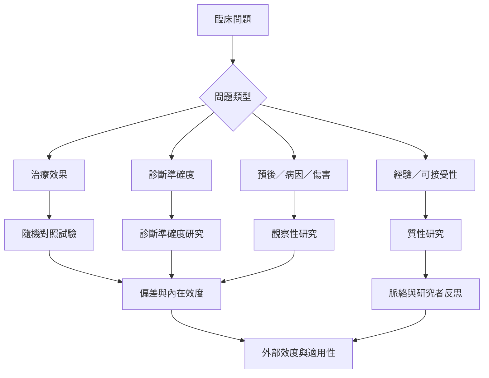

研究設計要從問題出發，再評估研究偏差、內外部效度和結果是否重要。這張地圖避免把單一研究設計視為所有問題的萬用答案。

## 永久筆記
* [[研究設計必須配合問題而不是服從單一證據金字塔]]
* [[隨機分派提高內在效度卻不保證外部適用性]]
* [[研究偏差可能從問題設定一路滲入到發表與指引]]
* [[質性證據能解釋治療如何被理解接受與實踐]]

## 概念
[[臨床流行病學]]、[[PICO問題架構]]、[[隨機對照試驗]]、[[觀察性研究]]、[[研究偏差]]、[[內在效度]]、[[外部效度]]、[[診斷準確度]]、[[質性證據綜合]]、[[臨床試驗註冊]]

## 文獻
[[使用者醫學文獻指南提供從研究閱讀走向臨床應用的完整教材]]、[[如何閱讀論文必須同時理解方法學統計與適用情境]]、[[隨機對照試驗仍需檢查外部效度盲法與隨機後偏差]]、[[患者與公眾參與能讓研究回應生活中真正重要的問題]]
