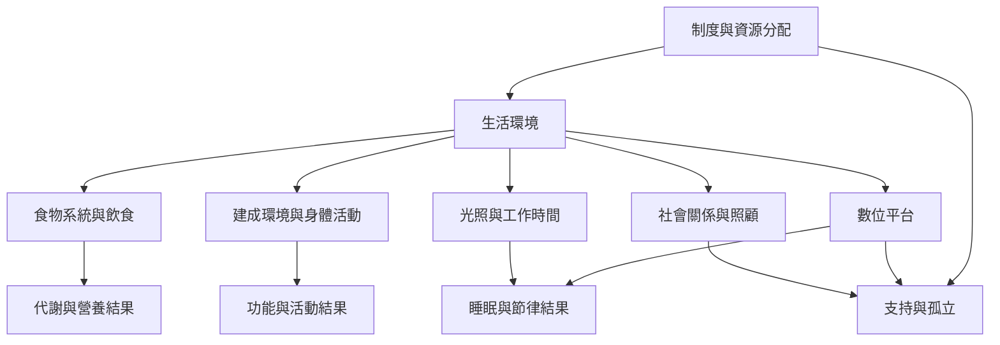

本圖將飲食、活動、睡眠、社會關係與數位科技放在同一張健康環境地圖。這些議題不是孤立習慣，而是由食物系統、城市、工作制度、社群支持與科技設計共同形成。

## 概念與筆記
* [[note/飲食演化不是一張可複製的古代食譜]]
* [[note/身體會補償活動量變化因此總能量消耗不等於運動量]]
* [[note/睡眠失配重點在節律與制度而非複製祖先時數]]
* [[note/社會支持的設計比孤立的個人自律更重要]]
* [[note/數位科技既可能製造也可能緩解社會失配]]
* [[term/晝夜節律]]
* [[term/異穩態]]
* [[data/演化失配生活型態量表把多種日常行為納入測量]]
* [[data/加拿大北極 Inuit 的飲食轉型同時涉及殖民貧窮與氣候變遷]]
* [[data/小島國的食物自主與傳統食物系統有助氣候韌性]]
* [[data/太平洋島嶼居民將糖尿病連結到殖民時期的食物與經濟變遷]]
* [[data/薩摩亞食物供應變化顯示營養轉型必須追蹤食物系統]]
* [[note/營養轉型需要分析食物供應系統而非生物失配]]
* [[idea/以食物自主與地方知識回應營養轉型]]
