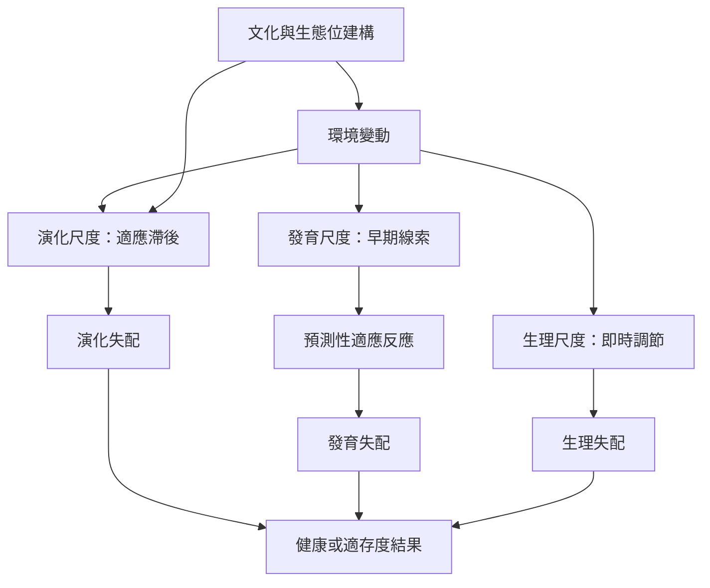

本圖把失配分為演化、發育與生理時間尺度，並連結適應滯後、發育可塑性與演化醫學。核心問題不是泛稱「現代生活不適合人類」，而是指出何種環境線索、何種追蹤機制、何種時間落差造成何種結果。

## 概念與筆記
* [[term/演化失配]]
* [[term/適應滯後]]
* [[term/發育失配]]
* [[term/生理失配]]
* [[term/預測性適應反應]]
* [[term/演化醫學]]
* [[note/失配必須按演化發育與生理的時間尺度分層]]
* [[note/早年環境可能使身體預測一個後來不會出現的世界]]
* [[data/演化失配整合理論把演化發育與生理放入多時間尺度]]
