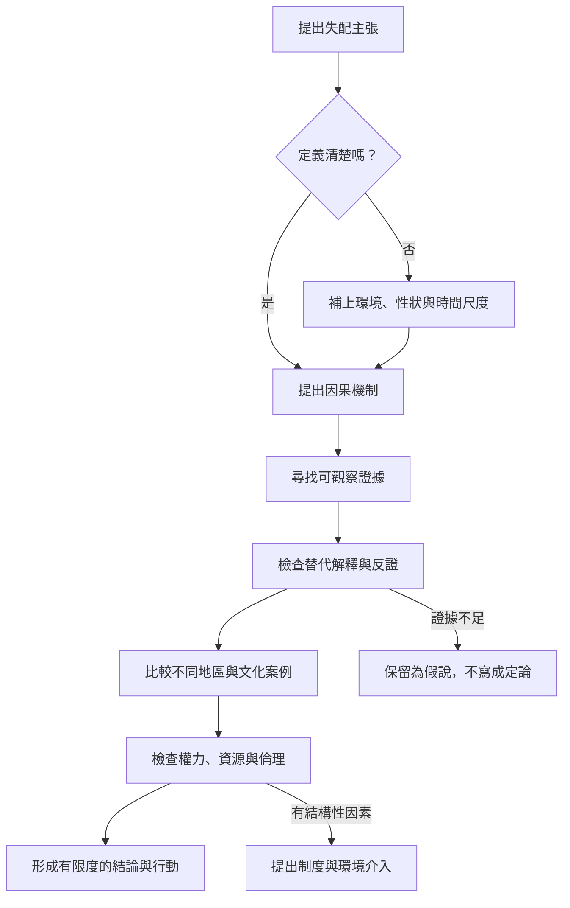

本圖提供閱讀與撰寫演化失配研究時的檢核程序：定義、機制、證據、替代解釋、文化範圍與倫理後果。它用來防止適應故事化、過度普遍化與個人責任化。

## 概念與筆記
* [[note/失配主張必須提出可檢驗的因果機制]]
* [[note/演化上的適應不等於現代生活的道德標準]]
* [[note/人類沒有單一且固定的祖先生活環境]]
* [[note/健康失配分析必須納入權力與資源分配]]
* [[idea/建立失配證據卡以區分故事關聯與因果]]
* [[term/適應主義]]
* [[term/生物文化取徑]]
* [[data/演化解釋必須避免把適應故事當成證據]]
* [[data/失配在演化醫學中具有多種可區分的嚴格用法]]
