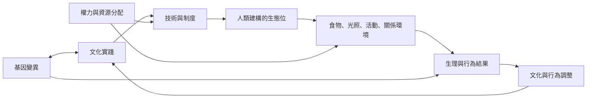

人類不是被動承受環境，而是透過文化、科技、制度與基礎設施建構環境。環境改變又回過頭影響身體、行為與社會關係，形成回饋迴路。

## 概念與筆記
* [[term/基因文化共演化]]
* [[term/生態位建構]]
* [[term/生物文化取徑]]
* [[note/文化改變選擇環境而基因也可能回應文化]]
* [[note/人類會建構環境而不只是被環境塑造]]
* [[note/健康失配分析必須納入權力與資源分配]]
* [[data/乳糖酶持續表達呈現飲食文化與基因的共同演化]]
* [[data/數位科技可能加劇失配也可能修補失配]]
* [[note/營養轉型需要分析食物供應系統而非生物失配]]
* [[data/太平洋島嶼居民將糖尿病連結到殖民時期的食物與經濟變遷]]
