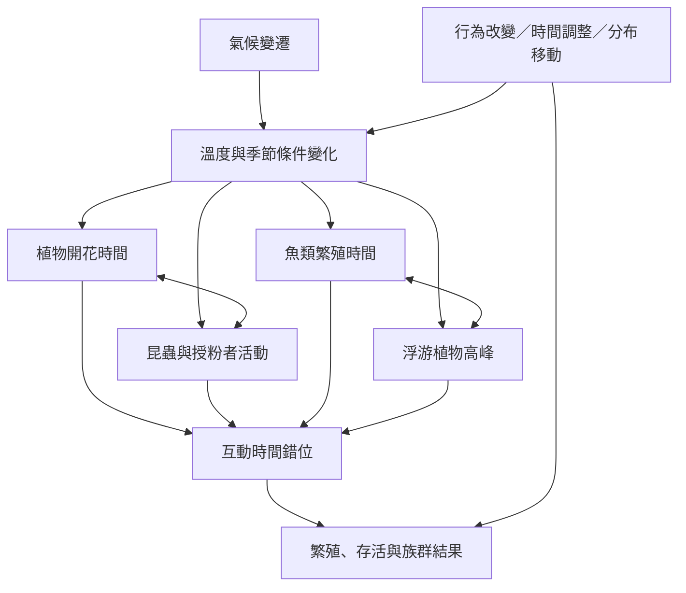

生態失配常以物候錯位為核心：互動物種的需求時點與資源高峰不同步。研究必須從事件時間的差異，進一步連結到繁殖、存活、族群動態或生態網絡的結果。

## 概念與筆記
* [[term/生態失配]]
* [[term/物候失配]]
* [[term/生態位]]
* [[note/生態失配需要把時間錯位連到實際族群結果]]
* [[note/環境改變後重新對齊可以發生在行為時間與空間三個維度]]
* [[data/物候失配會使互動物種的需求與資源供應錯開]]
* [[data/氣候變遷下物種可透過行為時間與空間追逐生態位]]
* [[data/魚類繁殖與浮游植物高峰錯位可能影響魚群補充量]]
