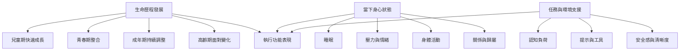

執行功能在生命歷程中逐步發展，也會受到睡眠、壓力、運動、關係與任務負荷影響。這張地圖把「發展」與「狀態」放在一起理解。

核心概念：[[執行功能]]、[[自我調節]]、[[前額葉皮質]]、[[共同調節]]。

相關筆記：[[執行功能會在生命歷程中變化而非固定不變]]、[[執行功能會隨身心狀態與環境負荷波動]]、[[身體活動可能透過多條路徑支持執行功能]]。

知識庫導讀：[[Executive_functions]]
