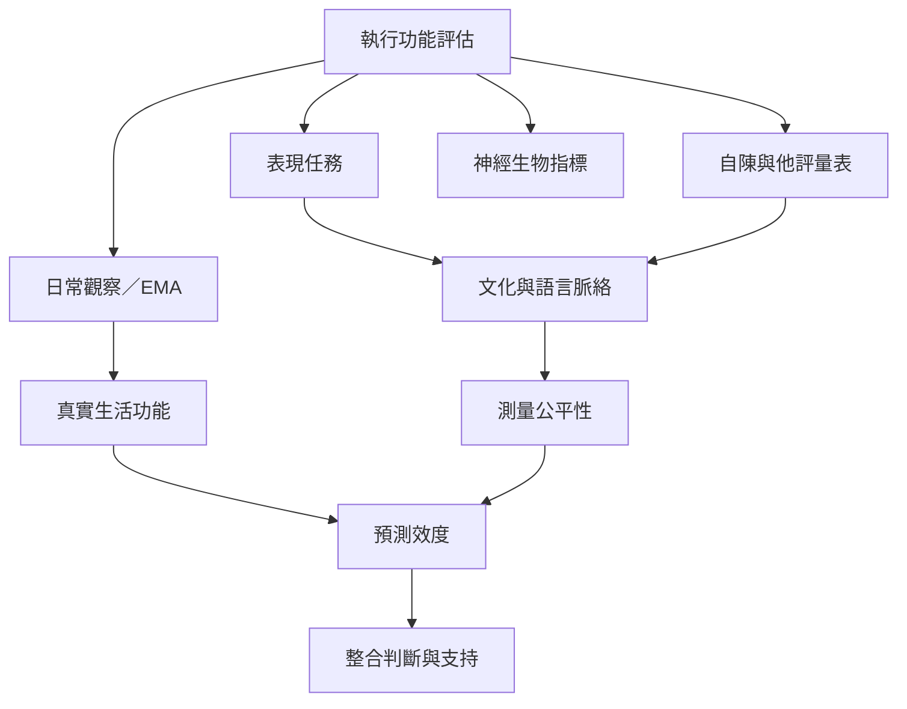

測量執行功能不只需要可靠的測驗，也要知道測驗是否適應文化、能否預測日常功能，以及不同測量方法是否彼此補充。

核心概念：[[生態效度]]、[[執行功能]]、[[注意力]]、[[認知卸載]]。

相關筆記：[[執行功能測驗看似貼近日常不等於具有生態效度]]、[[日常執行能力需要結合測驗與生活中的反覆觀察]]、[[執行功能測量必須區分能力差異與文化熟悉度]]。

知識庫導讀：[[Executive_functions]]
