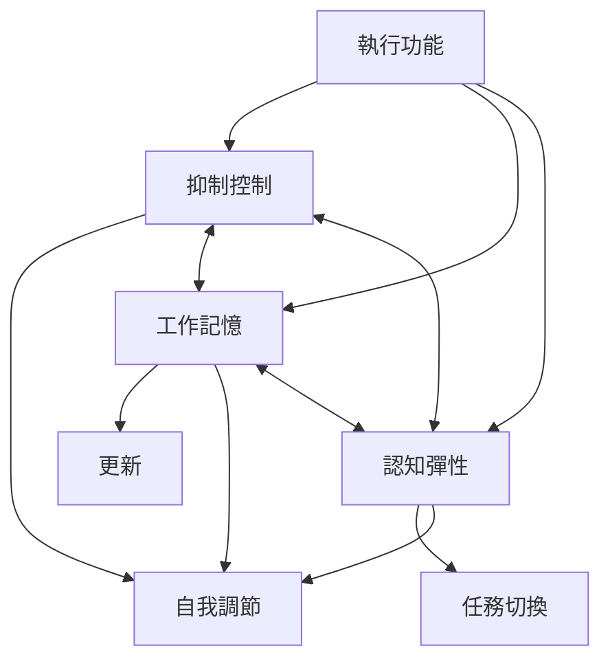

執行功能不是單一能力，而是由相互關聯又可區分的控制歷程組成。這張地圖以三核心模型為入口，並連接更新、任務切換與自我調節。

核心概念：[[執行功能]]、[[抑制控制]]、[[工作記憶]]、[[認知彈性]]、[[更新]]、[[任務切換]]、[[自我調節]]。

延伸閱讀：[[執行功能不是單一能力而是既統一又多樣的控制歷程]]、[[抑制控制不是壓抑念頭而是調整反應的能力]]。

知識庫導讀：[[Executive_functions]]
