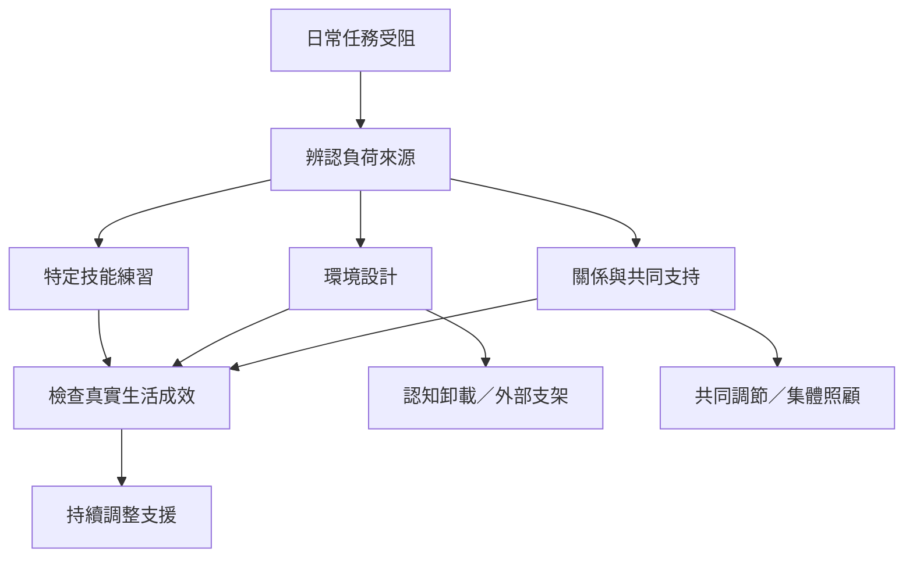

執行功能的支持不應只聚焦於訓練個體，更可透過生活流程、空間設計、工具與關係協作，降低不必要的執行負荷。

核心概念：[[執行功能]]、[[認知卸載]]、[[共同調節]]、[[自我調節]]。

相關筆記：[[把自律問題改寫成任務設計問題]]、[[用共同行事曆與輪值降低社群的記憶負擔]]、[[把執行功能教育從個人責任擴展到社會條件]]。

知識庫導讀：[[Executive_functions]]
