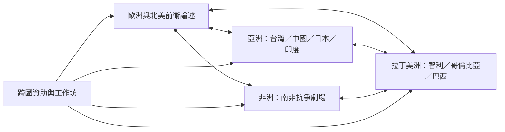

全球史不應被寫成歐洲發明、其他地區接受的單線擴散史。不同地區的劇場實驗有各自的政治、教育、文化與制度條件，也透過巡演、翻譯、工作坊與藝術家移動形成多方向交流。

核心文獻：[[data/跨國前衛表演並非由歐洲單向向外擴散]]、[[data/全球南方劇場的制度網絡塑造了戰後知識流動]]、[[data/實驗劇場研究的地理範圍擴大但性別偏差仍然存在]]。

區域路徑：
* 台灣：[[data/台灣小劇場運動在民主化脈絡中分化出激進美學]]。
* 中國：[[data/中國當代實驗劇場的歷史分期具有文化情境性]]。
* 日本：[[data/日本戰後實驗藝術連結劇場舞蹈與影像]]、[[data/舞踏觀看如何在互動中被組織]]。
* 印度：[[data/印度第三劇場的親民形式仍有內部排除問題]]。
* 南非：[[data/南非抗爭劇場把藝術視為介入政治現實的工具]]、[[data/南非政治劇場的跨國巡演可能引發互相矛盾的接收]]。
* 拉丁美洲：[[data/智利大學實驗劇場兼具劇場教育與公共文化使命]]、[[data/哥倫比亞卡利實驗劇團的集體創作方法重視共同研究]]、[[data/受壓迫者劇場把觀眾轉化為可以介入情境的行動者]]。
* 歐美另類與女性劇場：[[data/女性實驗劇場建立了不依附主流制度的創作空間]]、[[data/美國另類劇場將社會議題與感知實驗並置]]。

閱讀時同步使用 [[note/前衛形式的相似不代表各地歷史彼此相同]] 與 [[note/實驗劇場的正典需要同時檢查地理與性別偏差]] 作為史觀檢查。
