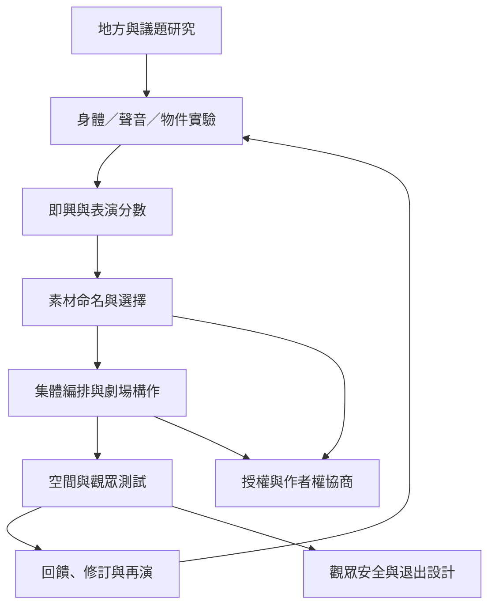

創作流程可由觀察、研究、素材生成、即興、編排、公開測試與修訂構成；不同團體會以不同順序循環。流程不是通用配方，而是讓決策、身體與場地成為可檢查的材料。

相關概念：[[term/即興]]、[[term/集體創作]]、[[term/表演分數]]、[[term/工作坊作為知識格式]]、[[term/劇場構作]]、[[term/身體劇場]]。

實踐資料：[[data/哥倫比亞卡利實驗劇團的集體創作方法重視共同研究]]、[[data/印度第三劇場的親民形式仍有內部排除問題]]、[[data/受壓迫者劇場把觀眾轉化為可以介入情境的行動者]]。

行動卡：[[idea/用感官注意力設計一段不依賴劇本文字的表演]]、[[idea/用決策紀錄把集體創作的權力關係變得可見]]、[[idea/建立一份不只保存成品的排練檔案]]。
