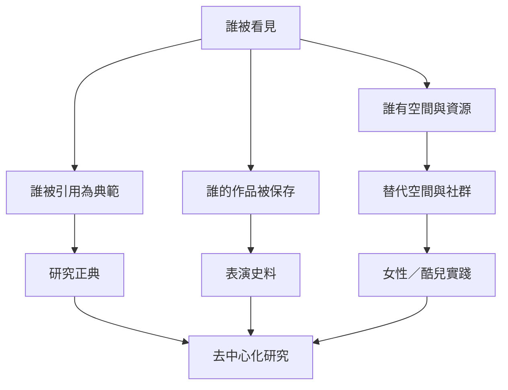

實驗劇場的歷史不只由美學創新者構成，也由場地、教育、資助、保存、評論與引用制度決定誰被看見。性別與地理偏差不是「名單不夠完整」而已，而是知識如何被生產與傳承的結構問題。

研究節點：[[data/實驗劇場研究的地理範圍擴大但性別偏差仍然存在]]、[[data/女性實驗劇場建立了不依附主流制度的創作空間]]、[[data/女性創作者的實驗性需要放回長時段劇場史]]、[[data/去中心化劇場研究要求改變知識生產的位置]]。

核心觀點：[[note/實驗劇場的正典需要同時檢查地理與性別偏差]]、[[note/實驗劇場的保存必須同時保存過程與關係]]。
