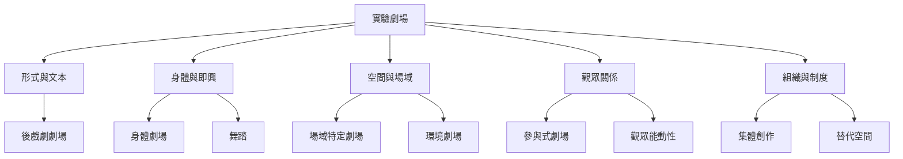

本圖把實驗劇場理解為一個多層次的實踐網絡：形式實驗、身體方法、空間安排、觀眾關係與組織制度彼此交織。核心不是追求新奇，而是辨認作品改變了什麼條件。

閱讀節點：[[term/實驗劇場]]、[[term/前衛表演]]、[[term/後戲劇劇場]]、[[term/身體劇場]]、[[term/即興]]、[[term/舞踏]]、[[term/集體創作]]、[[term/劇場構作]]、[[term/表演分數]]、[[note/實驗劇場是一種持續提問的方法而不是固定風格]]。

接著對照案例：[[data/台灣小劇場運動在民主化脈絡中分化出激進美學]]、[[data/日本戰後實驗藝術連結劇場舞蹈與影像]]、[[data/中國當代實驗劇場的歷史分期具有文化情境性]]。
