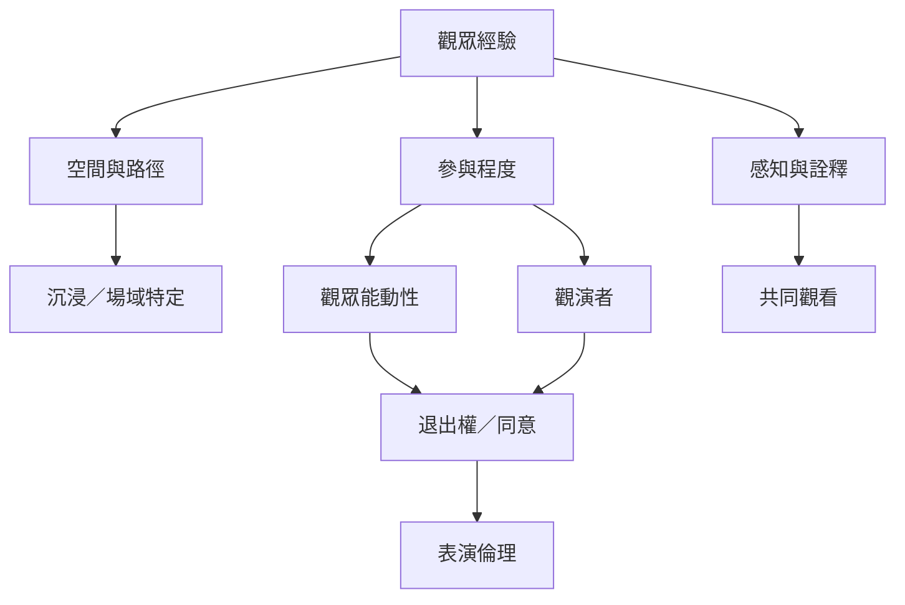

觀眾關係不能只用互動多寡衡量。需要一起分析空間如何導引行動、觀眾是否能改變事件、拒絕參與是否安全，以及表演如何取得故事與身體的使用同意。

主要研究：[[data/沉浸式劇場的空間與觀眾移動共同構成演出]]、[[data/沉浸式劇場中的場所圖式影響觀眾行為]]、[[data/舞踏觀看如何在互動中被組織]]、[[data/觀眾參與可以是敘事位置而非真正改變情節]]。

倫理與設計：[[note/觀眾參與會重新分配能動性卻不會自動消除權力]]、[[idea/設計參與式場景時先寫出可拒絕與可退出的規則]]、[[idea/以觀眾路徑實驗測試空間是否真正開放]]。
