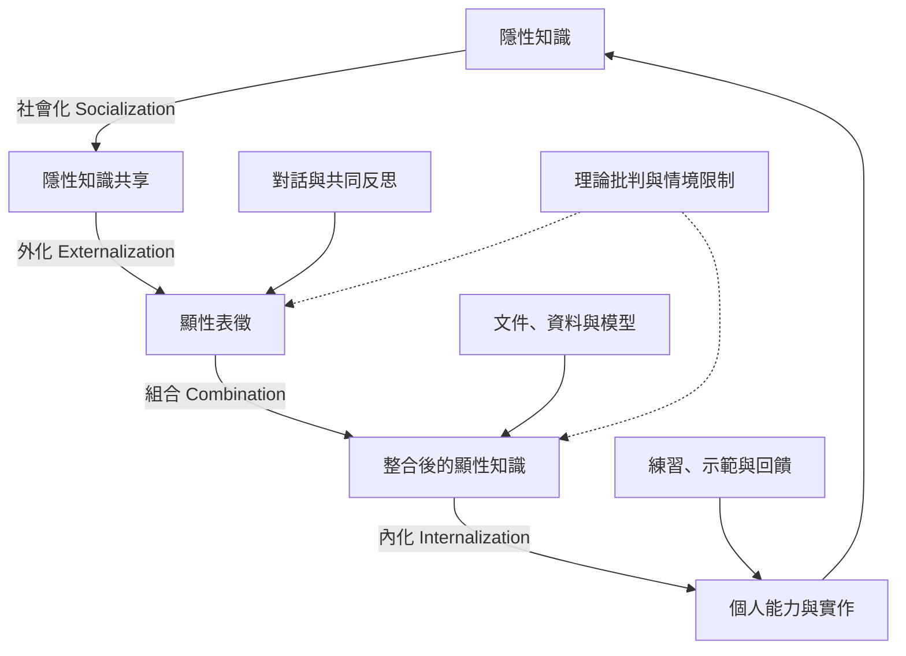

SECI 模型用四種互動描述知識如何在共同經驗、表述、整合與練習之間循環。圖中同時放入批判提醒：轉換模式是分析框架，不代表所有默會知識都能完整編碼。

延伸閱讀：[[SECI_model]]、[[Socialization]]、[[Externalization]]、[[Combination]]、[[Internalization]]、[[Tacit_knowledge]]、[[顯性化是共同解釋經驗而不是單純輸出文字]]、[[知識模型必須接受地方脈絡與實作者經驗的檢驗]]。
