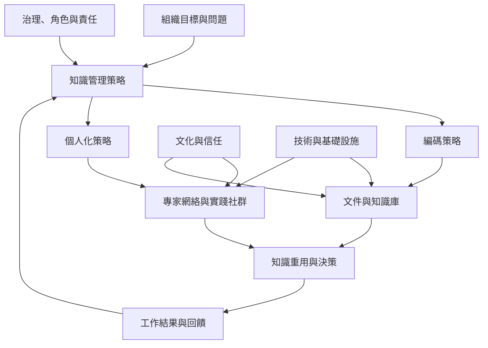

組織知識管理不是資料庫專案，而是由人際協作、工作流程、制度責任、文化誘因與資訊技術共同組成的社會技術系統。成效要看知識是否改善決策與行動，而不只是知識是否被存下來。

延伸閱讀：[[Knowledge_management]]、[[Knowledge_sharing]]、[[Communities_of_practice]]、[[Organizational_learning]]、[[Organizational_memory]]、[[Personalization]]、[[Codification]]、[[知識管理系統必須整合文化治理流程與技術]]、[[知識管理是一種維護集體記憶的持續公共勞動]]。
