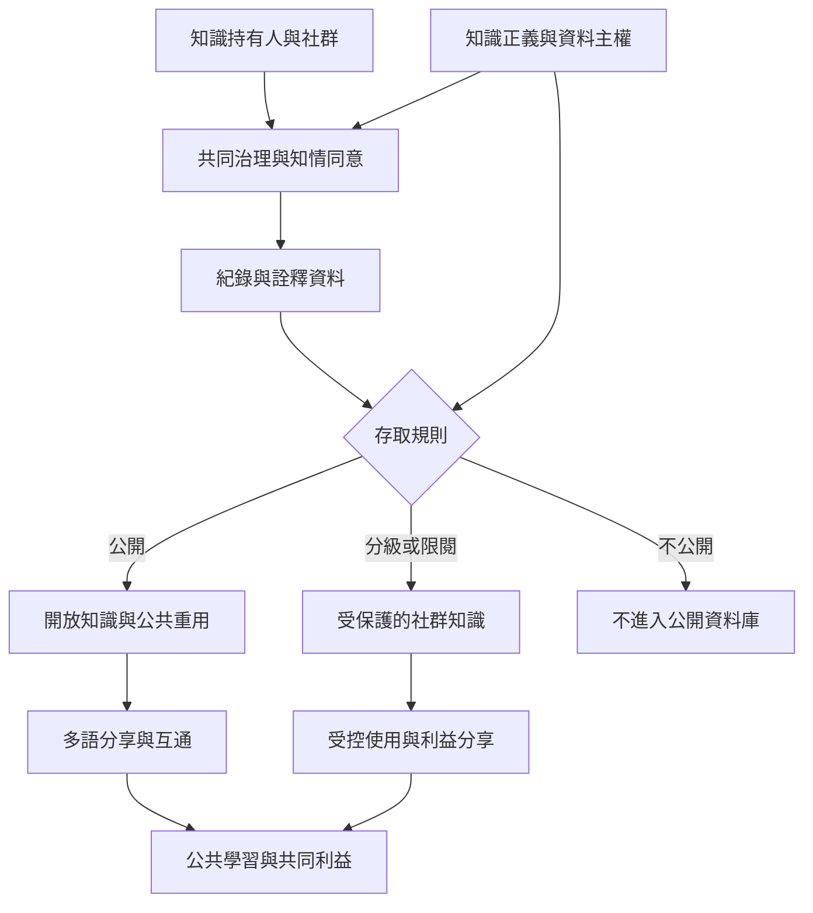

開放知識不是把所有資料無條件公開。它需要一併考量多語公平、共同利益、隱私、文化權利、知識持有人決策權、利益分享與長期維護。不同地區的公共知識基礎設施與原住民族資料治理案例，顯示開放與限制可以依社群規則並存。

延伸閱讀：[[Open_science]]、[[Indigenous_knowledge]]、[[Data_sovereignty]]、[[Epistemic_justice]]、[[Knowledge_governance]]、[[Knowledge_commons]]、[[開放知識不等於不設界限]]、[[知識治理必須回答誰有權記錄使用刪除與獲益]]、[[翻譯能擴展知識可及性也可能抹除地方差異]]。
