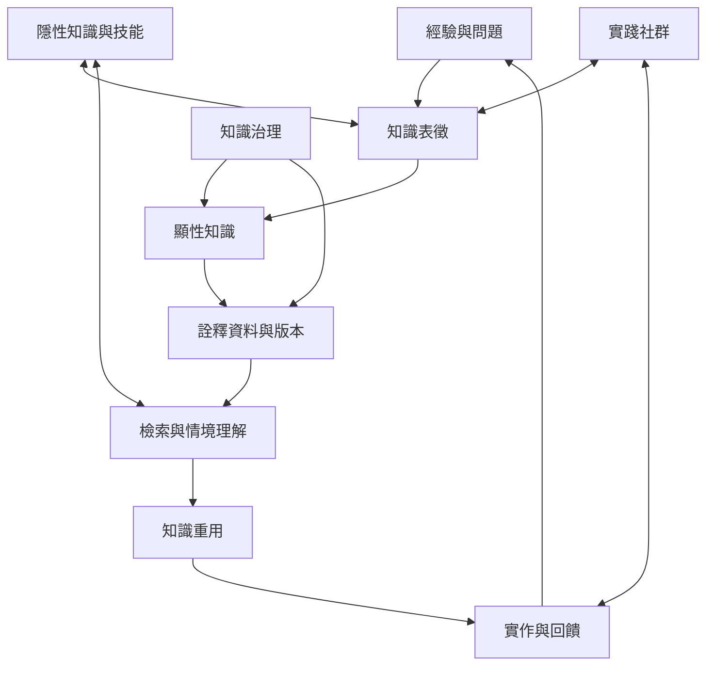

顯性知識可被保存與分享，但它需要詮釋資料、共同理解、實作與治理，才能成為可重複使用的集體資源。這張圖把「表述—保存—檢索—重用—回饋」連成循環，並指出人際社群與隱性知識始終參與其中。

延伸閱讀：[[Explicit_knowledge]]、[[Knowledge_representation]]、[[Codification]]、[[Knowledge_reuse]]、[[Metadata]]、[[Version_control]]、[[文件只有在使用情境中才成為可用知識]]、[[知識庫品質應以再次使用的能力而非累積數量衡量]]、[[編碼與人際交流構成互補的知識基礎設施]]。
