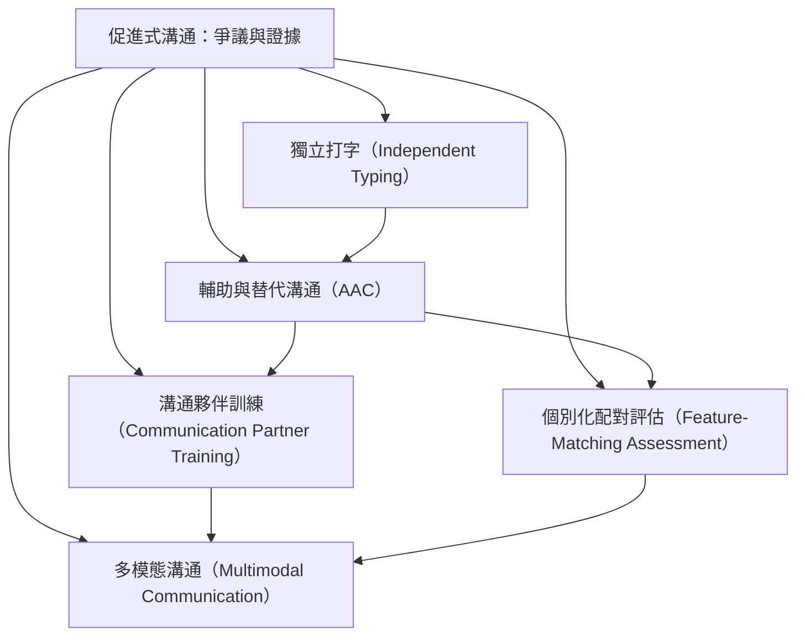

這張地圖整理不依賴單一協助者的溝通替代路徑。AAC 是工具、模式與策略的總稱，應按個別能力與生活情境配對；夥伴透過示範、等待、開放式提問與環境調整支持使用者，而不是代替使用者選字。

核心筆記：[[AAC是工具與策略的總稱而非單一裝置]]、[[AAC評估應依個別能力與生活情境配對]]、[[溝通夥伴能支持表達但不應接管訊息作者]]、[[非語言訊號也應被當成溝通的一部分]]。

概念入口：
* [[輔助與替代溝通（AAC）]]
* [[溝通夥伴訓練（Communication Partner Training）]]
* [[個別化配對評估（Feature-Matching Assessment）]]
* [[多模態溝通（Multimodal Communication）]]
* [[獨立打字（Independent Typing）]]

回到全書：[[Facilitated_communication]]
