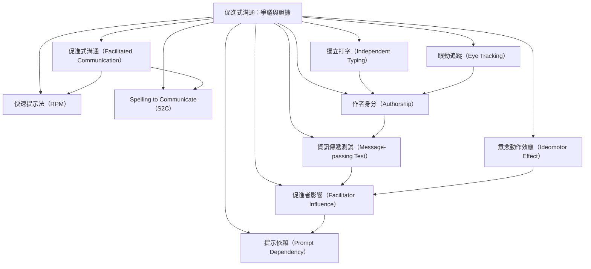

本概念地圖聚焦 FC、RPM、S2C 與相關協助式打字方法的區分，以及如何驗證訊息作者。研究的關鍵不是單看字句是否流暢，而是控制協助者掌握的資訊、提示與裝置位置，並觀察使用者能否獨立重現。不同研究工具各有測量邊界：資訊傳遞任務測試資訊來源，眼動與加速度計則測量注意與動作時序。

核心筆記：[[促進式溝通的關鍵驗證問題是訊息由誰撰寫]]、[[流暢而深刻的文字不能單獨證明作者身分]]、[[資訊隔離能把訊息作者問題轉化成可檢驗的研究]]、[[獨立打字與持續協助式打字必須分開評估]]、[[2026年系統性回顧未找到RPM與S2C的合格作者身分測試]]。

概念入口：
* [[促進式溝通（Facilitated Communication）]]
* [[快速提示法（RPM）]]
* [[Spelling to Communicate（S2C）]]
* [[作者身分（Authorship）]]
* [[資訊傳遞測試（Message-passing Test）]]
* [[促進者影響（Facilitator Influence）]]
* [[提示依賴（Prompt Dependency）]]
* [[意念動作效應（Ideomotor Effect）]]
* [[獨立打字（Independent Typing）]]
* [[眼動追蹤（Eye Tracking）]]

回到全書：[[Facilitated_communication]]
