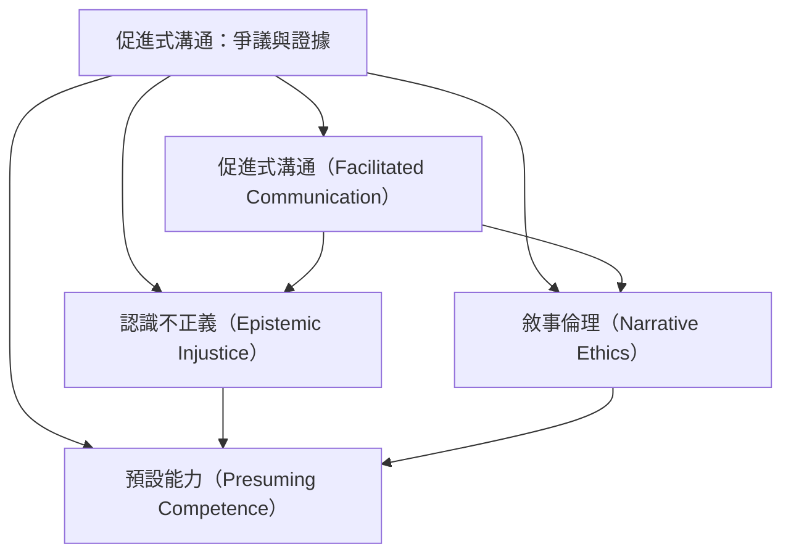

此地圖呈現促進式溝通從澳洲機構隔離背景發展、跨國倡議與專業組織回應，到近年媒體再興起的脈絡。歷史敘事與使用者經驗應被認真聽見；研究者也必須區分敘事內容、訊息來源與方法效度。

核心筆記：[[澳洲的機構隔離經驗構成促進式溝通的歷史起點]]、[[倡議者的經驗敘事需要被聽見但不能代替效度研究]]、[[The Telepathy Tapes引發對非口語者敘事權與證據倫理的爭論]]、[[敘事謙遜與敘事警覺需要並行]]。

概念入口：
* [[促進式溝通（Facilitated Communication）]]
* [[認識不正義（Epistemic Injustice）]]
* [[敘事倫理（Narrative Ethics）]]
* [[預設能力（Presuming Competence）]]

回到全書：[[Facilitated_communication]]
