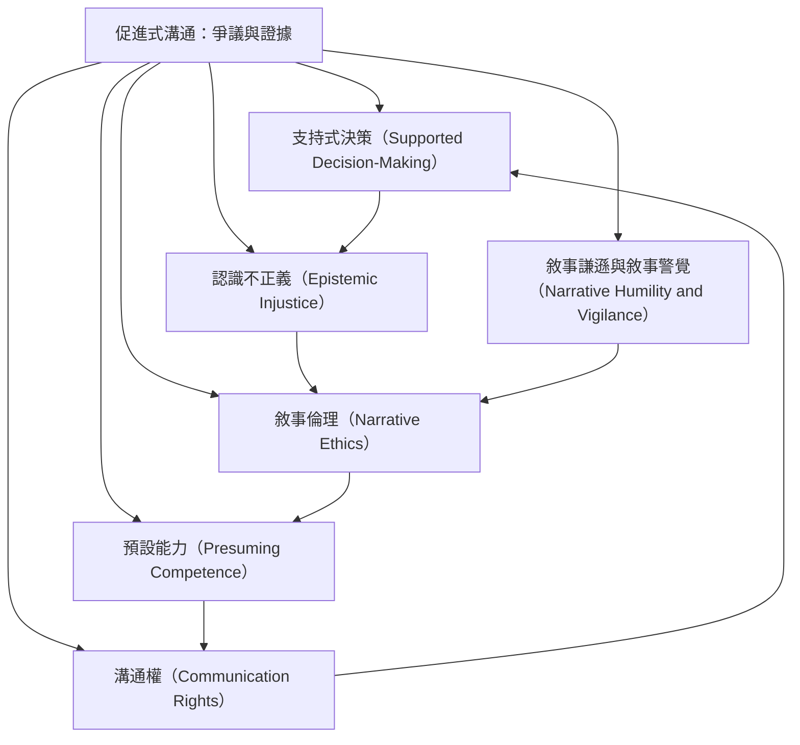

本地圖將溝通權、支持式決策、作者身分與臨床風險放在一起。CRPD 第 21 條要求提供多元、可近用的表達方式；但權利保障不能等同於認證任何特定技術。對醫療、法律、同意與虐待指控等高風險訊息，應確保來源透明、提供替代 AAC、獨立確認並保護當事人。

核心筆記：[[溝通權要求提供可行選項而非只禁止一種方法]]、[[支持式決策不應依賴未驗證的協助者訊息]]、[[作者不明的訊息不能單獨成為重大決策證據]]、[[促進式溝通的風險不應被溝通權口號掩蓋]]。

概念入口：
* [[支持式決策（Supported Decision-Making）]]
* [[溝通權（Communication Rights）]]
* [[認識不正義（Epistemic Injustice）]]
* [[敘事倫理（Narrative Ethics）]]
* [[預設能力（Presuming Competence）]]
* [[敘事謙遜與敘事警覺（Narrative Humility and Vigilance）]]

回到全書：[[Facilitated_communication]]
