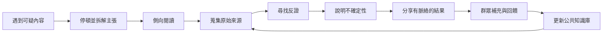

個人可以用主張拆解、側向閱讀、證據對照、分享前停頓與版本追蹤建立可持續的求證習慣；公民協作則能把個人查核結果轉化為可重用的公共知識。

## 概念連結
- [[建立一張主張卡讓查核從轉傳訊息開始]]
- [[用支持證據與反證兩欄降低確認偏誤]]
- [[把側向閱讀變成日常資訊檢查的預設動作]]
- [[在親友群組以共同求證取代羞辱式糾錯]]
- [[把查核素養融入閱讀與日常散步觀察]]
- [[為公共查核建立可共享的證據檔案]]
- [[群眾協作能擴大查核參與但需要品質治理]]
- [[認知謙遜]]
- [[資訊衛生]]
- [[群眾協作]]
- [[開放資料]]
- [[公共知識庫]]
- [[側向閱讀]]
- [[證據]]
- [[更正紀錄]]
