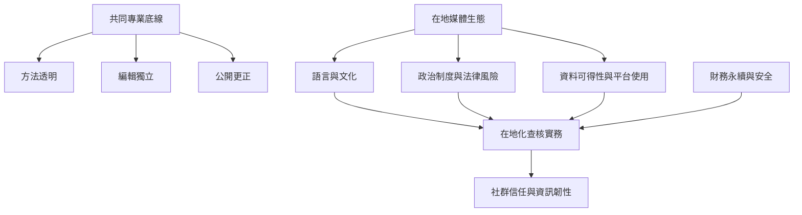

各地查核者共享證據追溯、透明與更正等底線，但其選題、語言、平台與安全策略必須回應在地政治與媒體生態。跨國比較應避免只用全球北方的經驗定義普遍標準。

## 概念連結
- [[國際事實查核網絡以五項承諾建立共同專業底線]]
- [[歐洲查核標準要求主張與證據都能被讀者追溯]]
- [[非西方查核文化的比較研究指出真相實踐具有在地性]]
- [[全球南方資訊韌性研究把查核連回治理與結構因素]]
- [[2026年全球查核組織調查顯示受眾成長與財務脆弱並存]]
- [[亞洲查核者面對語言工具限制安全風險與經費不穩]]
- [[全球查核標準需要在地化而不是複製]]
- [[在地知識]]
- [[跨文化查核]]
- [[資訊失序]]
- [[編輯獨立]]
- [[財務永續]]
- [[查核者安全]]
- [[平台治理]]
- [[資訊正義]]
