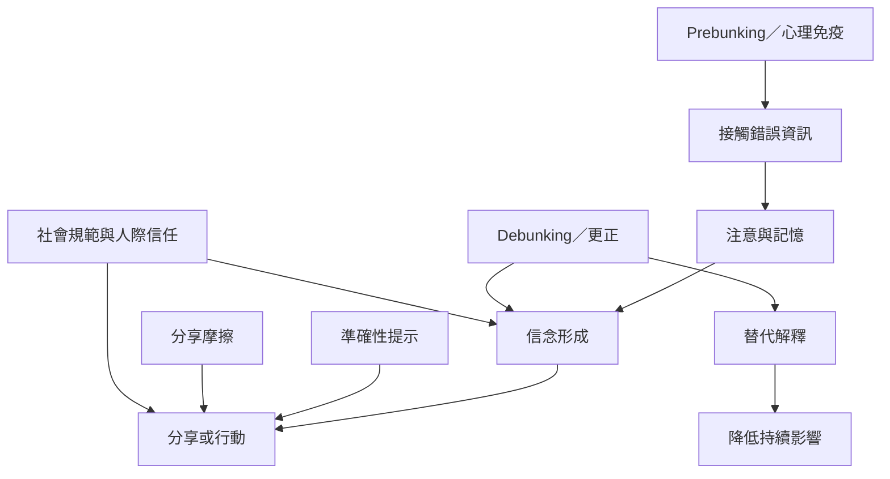

錯誤資訊形成後會受到記憶、動機、情緒與社會關係影響。事後更正、預先免疫、準確性提示與分享摩擦分別介入傳播鏈的不同位置，應以不同指標衡量。

## 概念連結
- [[錯誤資訊的持續影響來自記憶推理情緒與社會因素]]
- [[更正需要提供替代解釋而不只是否定]]
- [[更正通常能改善信念準確度但未必改變態度行為]]
- [[科學錯誤資訊的統合分析提醒更正效果不能一概而論]]
- [[準確性提示能把注意力從社交分享拉回內容可信度]]
- [[個人層級的錯假訊息介入包含九種不同工具]]
- [[把側向閱讀變成日常資訊檢查的預設動作]]
- [[錯誤資訊]]
- [[確認偏誤]]
- [[動機性推理]]
- [[更正]]
- [[Debunking]]
- [[Prebunking]]
- [[持續影響效應]]
- [[準確性提示]]
- [[心理免疫]]
- [[媒體識讀]]
