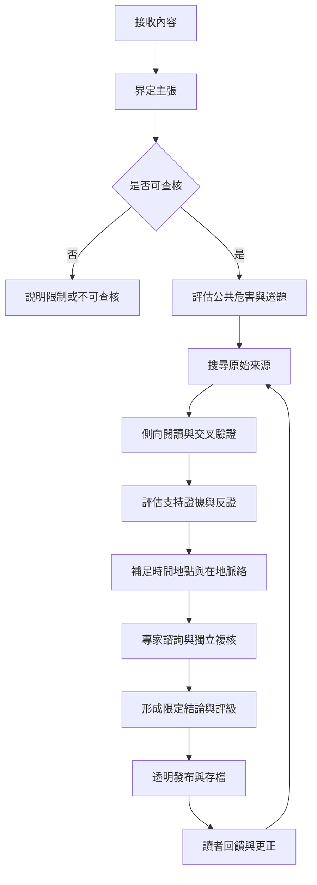

此圖從主張進入，經過選題、來源搜尋、證據評估、脈絡補足、複核與發布，再由讀者回饋與更正形成迭代流程。流程不是機械直線：遇到新資料時需要回到前面步驟。

## 概念連結
- [[查核流程必須從可檢驗的主張開始]]
- [[查核選題本身就是一種權力]]
- [[證據紀錄應同時容納支持與反證]]
- [[原始來源通常重要但不會自動等於可靠證據]]
- [[透明度讓查核成為可重做的公共程序]]
- [[評級是摘要而不是完整論證]]
- [[在地脈絡決定同一主張的實際意義]]
- [[專家意見需要回到可檢驗的證據]]
- [[讓查核報告保留版本與更新理由]]
- [[主張]]
- [[可查核性]]
- [[證據]]
- [[原始來源]]
- [[交叉驗證]]
- [[脈絡]]
- [[評級]]
- [[更正]]
