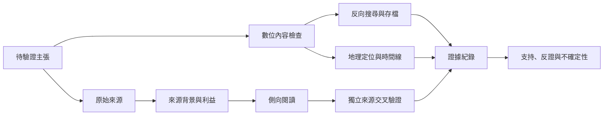

此圖將來源評估、原始資料、側向閱讀、開源情報與數位鑑識放在同一組驗證鏈中。不同方法可相互補強，但同一個來源或工具的重複輸出不能被誤認為獨立證據。

## 概念連結
- [[側向閱讀把來源評估從自我宣稱轉為外部交叉檢驗]]
- [[影像驗證必須拆開真實性時間與地點]]
- [[開源調查工具箱提供影像地理位置與網頁存檔線索]]
- [[生成式AI可以協助調查但不能替代證據判斷]]
- [[來源可信度不能由網站外觀推斷]]
- [[證據紀錄應同時容納支持與反證]]
- [[原始來源通常重要但不會自動等於可靠證據]]
- [[證據]]
- [[來源可靠度]]
- [[側向閱讀]]
- [[開源情報]]
- [[數位鑑識]]
- [[地理定位]]
- [[影像來源]]
- [[交叉驗證]]
- [[可重現性]]
