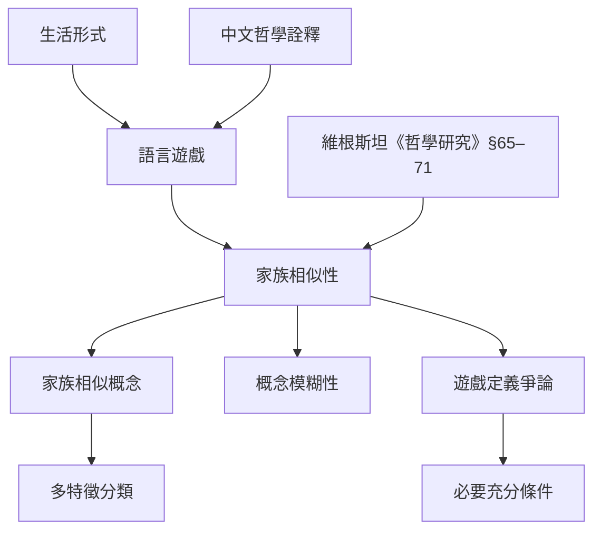

這張地圖呈現家族相似性在維根斯坦後期哲學中的位置：概念從具體語言使用出發，透過語言遊戲與生活形式形成可理解的關聯網絡。反本質主義不等於取消規則，而是拒絕預設所有概念都由同一種定義結構支配。

## 概念與筆記
* [[家族相似性]]、[[家族相似概念]]、[[語言遊戲]]、[[生活形式]]、[[概念模糊性]]、[[多特徵分類]]。
* [[家族相似性描述的是重疊交錯而非單一共同本質]]、[[概念邊界可以開放但不代表任意]]、[[概念使用依賴生活形式與語境]]。
* [[維根斯坦以語言遊戲展示概念不必共享單一本質]]、[[中文哲學研究將家族相似放回語境與語言遊戲的關聯之中]]、[[藝術概念的開放性促使美學家重新思考定義的任務]]、[[為遊戲提出定義的嘗試顯示家族相似不是唯一可用的方法]]。
