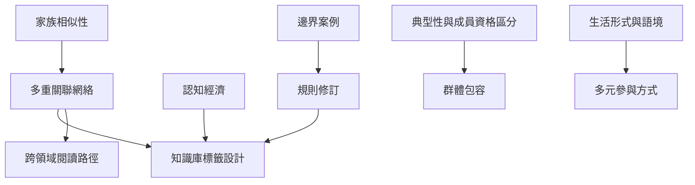

這張地圖把家族相似性轉成知識庫與共同活動的設計原則：分類需要降低搜尋成本，也要保存多重歸屬、脈絡與邊界案例。群體標籤和活動設計則可避免把單一典型成員或典型角色誤認為唯一標準。

## 概念與筆記
* [[家族相似性]]、[[認知經濟]]、[[生活形式]]、[[典型性效應]]。
* [[以家族相似畫出知識主題網絡而非建立僵硬樹狀分類]]、[[讓邊界案例成為修正概念的研究入口]]、[[比較不同社群如何理解同一個詞而不是假定翻譯完全對等]]、[[用家族相似檢查群體標籤是否把典型成員誤當成全部]]、[[為活動設計保留多種參與方式而不只設單一典型角色]]、[[建立可解釋的多重標籤並保留分類修訂紀錄]]、[[把醬即興視為可持續擴展的實踐家族而非固定人格標籤]]。
* [[分類制度應同時降低搜尋成本並保留世界的關聯結構]]、[[典型性是程度差異不等於類別成員資格]]。
