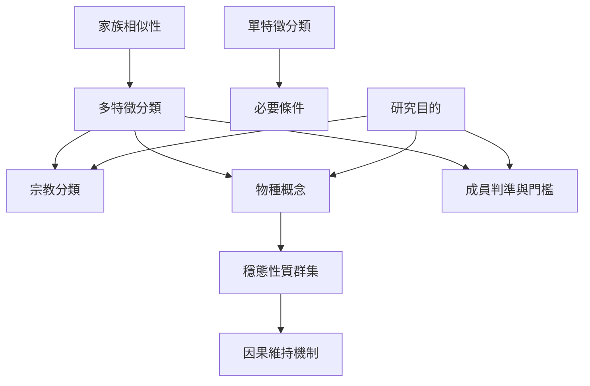

這張地圖說明，家族相似性的概念可以進入科學分類與社會研究，但需要更精確的操作化。多特徵分類允許不同成員具有不同性質組合；自然種類研究則追問性質群集是否由因果機制維持。宗教研究與生物物種研究顯示，分類的研究目的會影響判準。

## 概念與筆記
* [[多特徵分類]]、[[單特徵分類]]、[[穩態性質群集]]、[[分類]]、[[家族相似概念]]。
* [[聚類分類仍需說明納入判準與分類用途]]、[[物種分類要區分表面相似與維持特徵群集的因果機制]]、[[分類標準應隨研究目的而調整並公開]]。
* [[生物物種可被理解為多項性質共同維持的群集概念]]、[[宗教研究以多特徵方法避免宗教定義的僵硬二分]]、[[2025年的概念多元論重新檢視家族相似的來源與用途]]。
