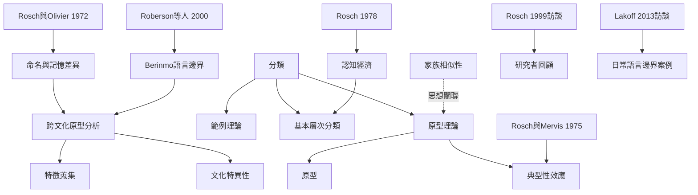

這張地圖整理家族相似性與認知科學之間的接點。Rosch 與 Mervis 把特徵重疊和典型性轉成實驗問題；Rosch 的後續整理區分類別結構與心理機制。Dani 與 Berinmo 的色彩研究形成一組重要對照：命名、記憶與類別邊界不能混為一談。近年的跨文化指南則強調先從參與者自身產生特徵，並檢查原型是否受文化、情境與時間影響。研究者訪談可以補充問題意識與研究史，但不能取代實證研究。

## 概念與筆記
* [[分類]]、[[原型理論]]、[[原型]]、[[典型性效應]]、[[範例理論]]、[[基本層次分類]]、[[認知經濟]]。
* [[家族相似性不等同原型理論]]、[[典型性是程度差異不等於類別成員資格]]、[[原型會隨情境與時間改變]]、[[跨文化分類要讓當事人產生特徵再比較]]。
* [[Rosch與Mervis以特徵重疊解釋類別典型性]]、[[Rosch以跨文化色彩研究顯示自然類別的典型結構值得實驗檢驗]]、[[Rosch與Olivier比較美國與Dani語言顯示色彩命名和記憶的影響不同]]、[[Berinmo研究修正色彩典型性具有普遍性的強主張]]、[[Rosch將認知經濟與世界結構視為分類系統的兩項原則]]、[[跨文化原型分析能同時呈現共通性與文化特異性]]、[[原型理論能解釋典型性卻無法單獨解釋所有概念判斷]]。
* [[Rosch從典型性研究轉向整體性的第一人稱訪談補充了她自身的知識脈絡]]、[[Lakoff在訪談中主張自然語言分類不能化約為二元集合]]、[[色彩分類需要同時檢查知覺顯著性與語言社會慣例]]、[[訪談能呈現研究者的問題意識但不能取代實證證據]]。
