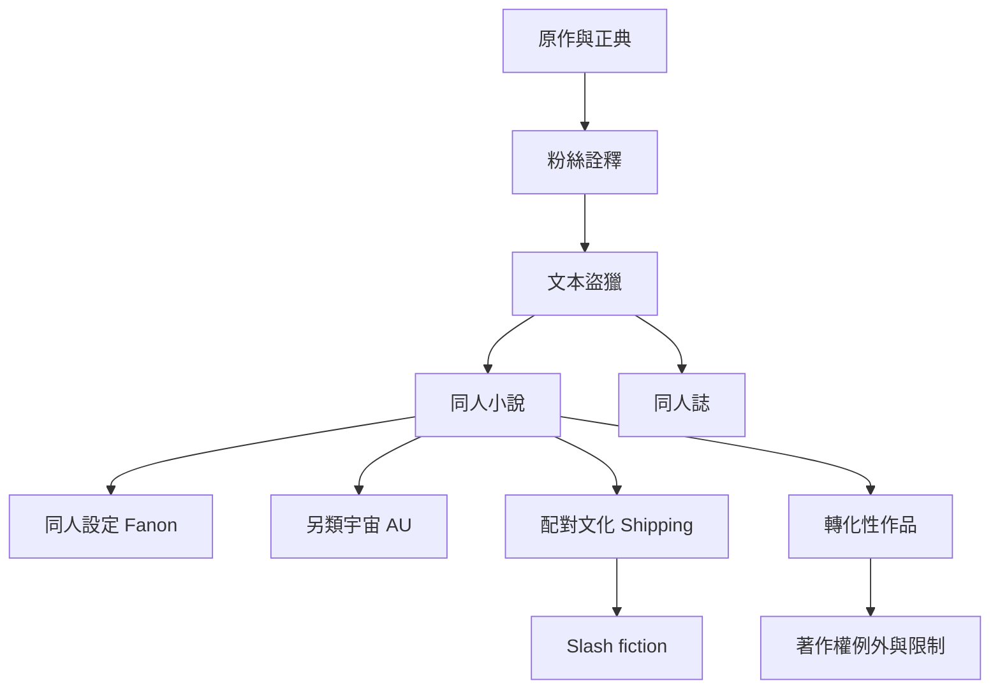

同人創作是粉絲對既有文本進行選擇、改寫與再脈絡化的實踐。從[[正典（Canon）]]到[[同人設定（Fanon）]]，從[[文本盜獵（Textual poaching）]]到[[轉化性作品（Transformative work）]]，粉絲透過人物、關係、世界與敘事空白創造新的閱讀路徑。不同地區發展出各自的傳統，例如日本[[同人誌（Dōjinshi）]]、英語社群的[[Slash fiction（斜線配對同人）]]，以及中文語境中的同人／耽美作品。

本圖描述常見概念關係，不代表每篇同人作品都依照固定流程產生。閱讀本地圖時，可搭配[[同人創作以再詮釋而不是複製回應原作]]、[[粉絲是知識與文化生產者而不只是內容消費者]]與[[性別與酷兒解放不能只用角色配對衡量]]。
