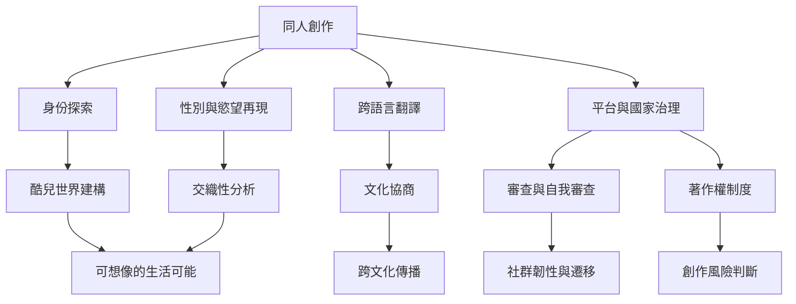

同人作品在不同社會脈絡中承載身份探索、慾望表達、文化翻譯與政治協商。這些工作同時受到性別、種族、平台、法律與語言權力影響；跨區比較必須保留地方歷史，而不能把英語平台的規範當成全球標準。

此圖連結[[同人作品提供試演身份與親密關係的空間]]、[[性別與酷兒解放不能只用角色配對衡量]]、[[翻譯是一種文化協商而非字詞轉換]]與[[作品的法律風險取決於所在地與具體情境]]。區域比較可從[[日本同人誌文化讓女性創作者重寫慾望與媒介文本]]、[[中國同人作者在審查壓力下重組互惠網絡]]與[[拉丁美洲粉絲研究需要在地問題與學術網絡]]展開。
