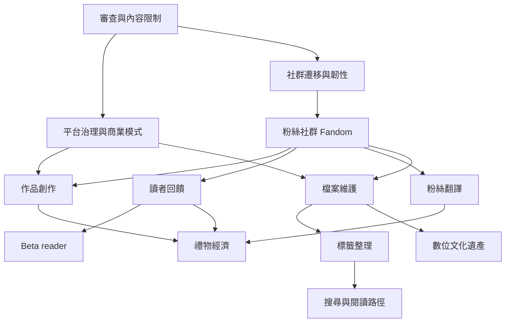

同人創作依賴的不只是作者與讀者，也包括回饋者、譯者、檔案志工、標籤整理者與平台治理。這些工作構成社群的[[禮物經濟（Gift economy）]]與共享知識基礎；平台的商業模式、審查與保存規範則會改變作品如何流通。

這張圖把作品流通與社群維護放在同一張地圖上。延伸閱讀：[[同人社群依靠互惠勞動與非正式協作維持創作]]、[[檔案平台把標籤轉化為閱讀與探索的基礎設施]]、[[審查破壞的不只是內容而是社群關係]]與[[同人作品的保存需要把社群視為文化遺產]]。
