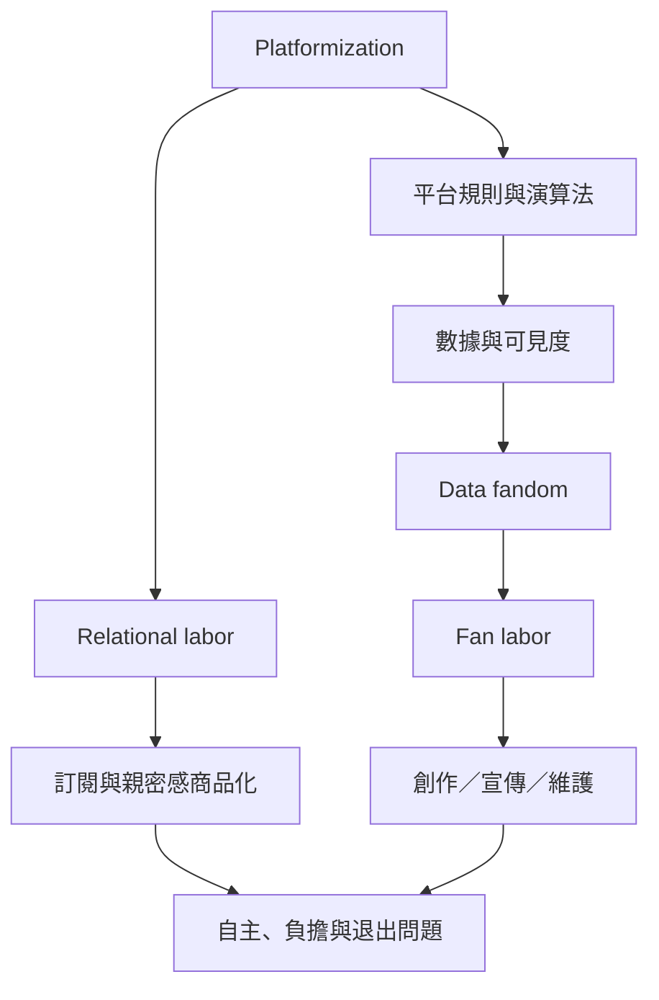

數位平台提供互動與連結，同時以演算法、指標、訂閱和內容治理重塑粉絲參與。粉絲的創作、宣傳、翻譯與維繫關係可能成為無償或被商品化的勞動。

此圖連結 [[平台指標把情感轉化為可量化的勞動]]、[[親密感的商品化讓偶像關係成為訂閱服務]] 及 [[為粉絲社群設計不以消費與在線時數衡量忠誠的文化]]。

## 參考
* [[Data fandom]]、[[Fan labor]]、[[Relational labor]]、[[Platformization]]。
* [[Fandom]]。
