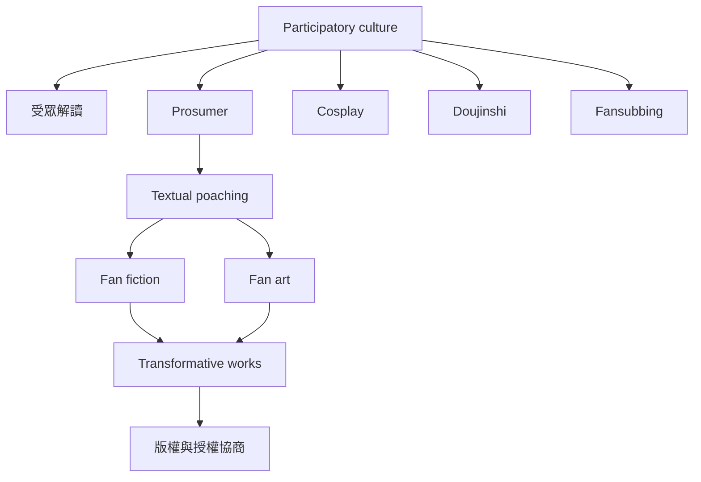

粉絲參與從閱讀、討論延伸到創作、翻譯、展演與社群策劃。參與式文化提供理解框架，文本盜獵與轉化性作品則說明粉絲如何重新處理原作素材。

此圖連結 [[同人創作讓原作成為可再協商的素材]]、[[粉絲關係不是單純消費而是共同建構意義]] 與 [[以粉絲共創作品進行表達但先確認授權與界線]]。

## 參考
* [[Textual poaching]]、[[Fan fiction]]、[[Fan art]]、[[Participatory culture]]、[[Transformative works]]。
* [[Fandom]]。
