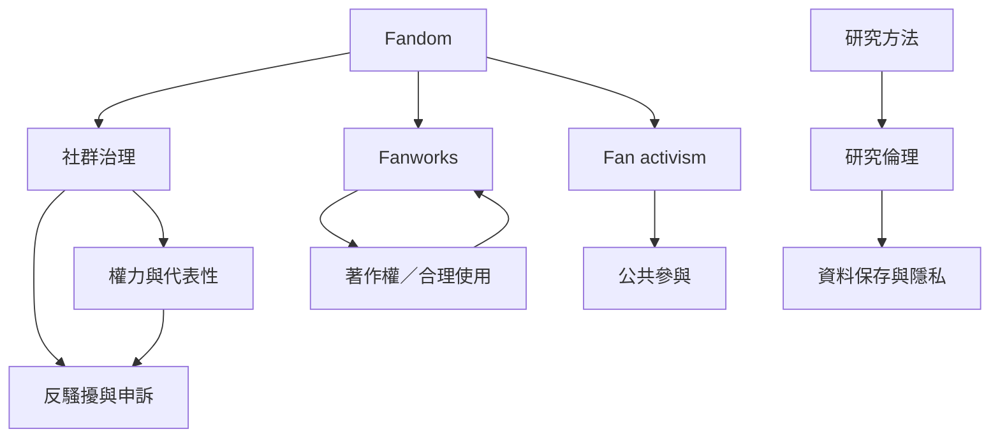

粉絲社群需要同時處理創作權利、社群治理、研究倫理與公共參與。粉絲能轉化共同情感為倡議，但社群規則、著作權和資料使用仍有具體邊界。

此圖連結 [[讓粉絲社群的規則透明且能被成員共同修訂]]、[[把社群衝突轉化為可檢驗的共同問題而非忠誠測驗]]、[[建立由粉絲共同治理的開放檔案而非依賴單一平台]]。

## 參考
* [[Fan activism]]、[[Transformative works]]、[[Fan studies]]。
* [[Fandom]]。
