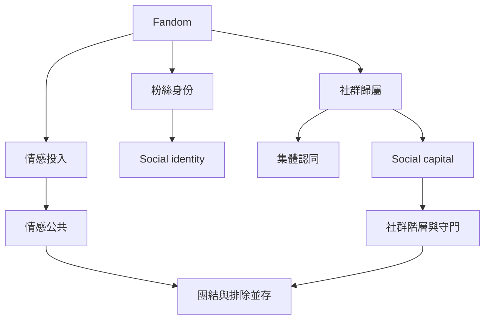

粉絲身份不是一個單獨標籤，而是情感投入、群體認同、社群關係與邊界協商的交會。共同喜愛讓人形成歸屬，也可能產生內部階層與外部排斥。

此圖連結 [[粉絲身份是一種可變動的關係性定位]]、[[粉絲知識是一種社群資本也會變成門檻]]、[[社群歸屬同時創造團結與邊界]]，也可回到 [[粉絲研究把Fandom視為情感投入身份實踐與社群歸屬]]。

## 參考
* [[Fan studies]]、[[Social capital]]、[[Collective identity]]、[[Affective publics]]。
* [[Fandom]]。
