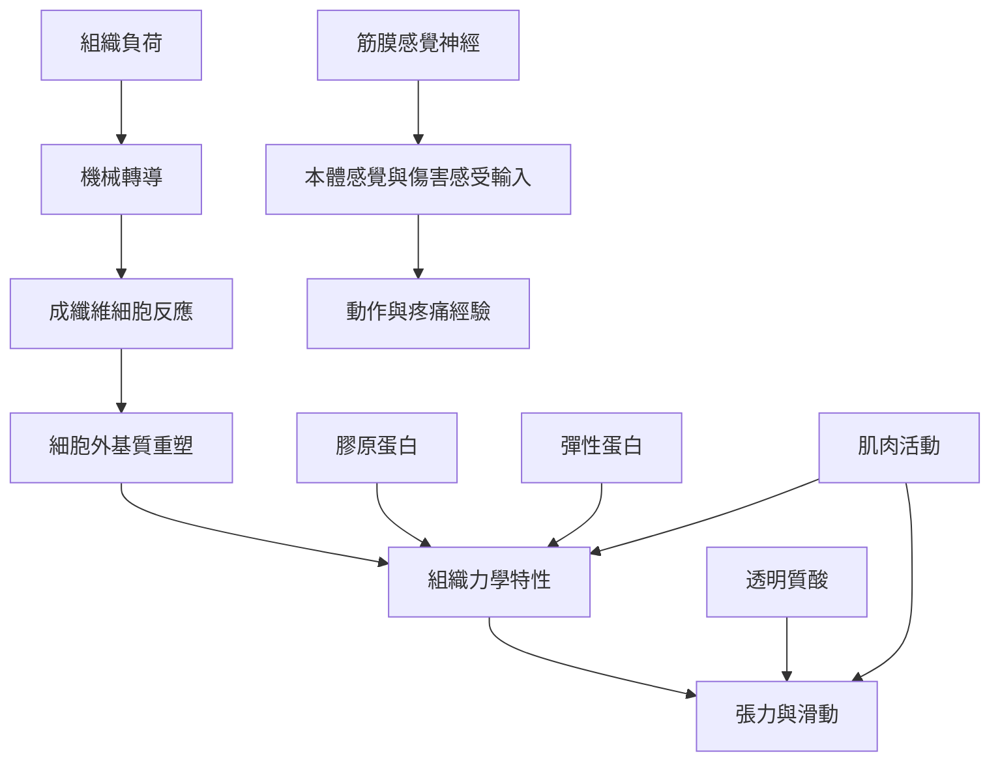

筋膜相關組織的功能來自纖維排列、細胞外基質、組織界面、神經輸入與周圍肌肉活動的共同作用。它可能參與局部張力承受、層間滑動、肌群間力量傳遞，以及身體位置和疼痛訊號的感知。這些功能在不同身體區域並不相同，不能簡化成單一「筋膜張力」。

核心概念包括[[機械轉導]]、[[膠原蛋白]]、[[彈性蛋白]]、[[透明質酸]]、[[本體感覺]]、[[傷害感受]]、[[內感受]]、[[胸腰筋膜]]與[[筋膜鏈]]。

## 閱讀提示
先理解[[機械轉導]]與[[細胞外基質]]，再討論力量傳遞和感覺功能。請注意「神經存在」不等於「該組織能完整提供某種感覺」，也不等於每一處筋膜都具有相同受器。

## 參考
* [[筋膜的機械功能來自纖維結構與可變形基質協作]]
* [[身體的力量傳遞不只沿著肌腱也可跨肌肉結締組織發生]]
* [[筋膜的感覺功能可能參與身體定位和疼痛但各區域不能一概而論]]
