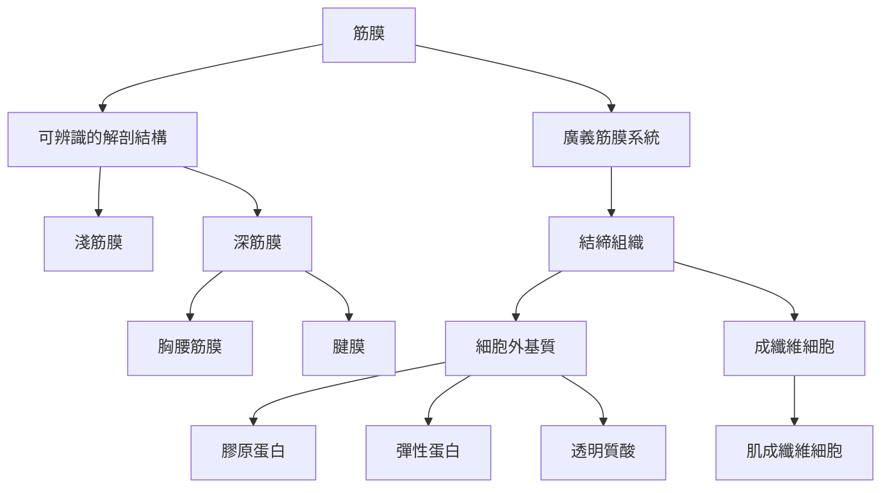

筋膜的解剖理解可由「組織是什麼、位於哪裡、由什麼構成」三個問題開始。狹義筋膜指可辨識的纖維結締組織膜片與鞘；廣義筋膜系統則描述其跨身體的功能連續性。兩者不能混用，尤其在比較不同研究時，需要先確認操作定義。

核心概念包括[[筋膜]]、[[筋膜系統]]、[[結締組織]]、[[淺筋膜]]、[[深筋膜]]、[[胸腰筋膜]]、[[腱膜]]、[[細胞外基質]]、[[膠原蛋白]]、[[彈性蛋白]]、[[透明質酸]]、[[成纖維細胞]]與[[肌成纖維細胞]]。

## 閱讀提示
先從[[筋膜]]與[[結締組織]]建立分類，再讀[[細胞外基質]]和纖維成分；之後進入[[深筋膜]]與[[胸腰筋膜]]的局部解剖。當資料討論「全身筋膜網絡」時，回頭檢查其定義是否與狹義解剖一致。

## 參考
* [[筋膜不是一層包裝而是分層且交織的結締組織系統]]
* [[筋膜研究需要同時保持局部解剖精度與整體功能視角]]
* [[筋膜命名共識以單一筋膜與整體筋膜系統區分解剖和功能]]
