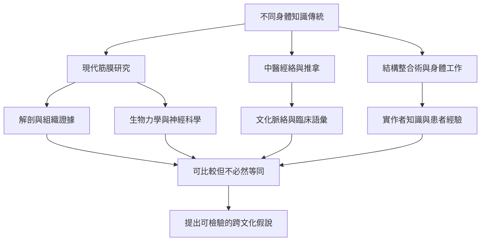

筋膜研究連接現代解剖學、復健與手法治療，也與不同文化的身體實踐產生對話。結構整合術、推拿與經絡理論各有不同的歷史和概念系統。研究可嘗試尋找組織或感覺層面的交集，但不能把文化概念直接等同於解剖結構。

核心概念包括[[經絡]]、[[結構整合術]]、[[肌筋膜放鬆]]、[[筋膜鏈]]、[[筋膜系統]]與[[疼痛]]。

## 閱讀提示
優先閱讀歷史與質性材料，先理解各自的身體觀；再引入生物醫學測量，辨認哪些部分可以對照、哪些仍不可互譯。任何跨文化主張都應保留來源與不確定性。

## 參考
* [[經絡與筋膜的相似性提供跨文化研究假說不等於概念等同]]
* [[中國推拿的歷史脈絡不能直接化約為筋膜手法]]
* [[結構整合術的歷史呈現身體工作與科學驗證的交會]]
