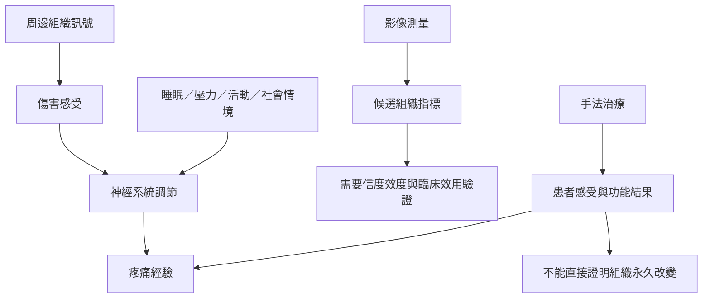

筋膜可以成為疼痛訊號的周邊來源，也可能透過機械和感覺關係參與部分肌肉骨骼症狀；但慢性疼痛往往是多層次現象。臨床介入研究必須區分患者感受、功能結果、組織影像和推測的治療機制。手法治療可以是整合照護的一部分，但不能被宣稱為唯一解方。

核心概念包括[[疼痛]]、[[傷害感受]]、[[中樞敏化]]、[[肌筋膜疼痛症候群]]、[[肌筋膜放鬆]]與[[超音波彈性成像]]。

## 閱讀提示
先讀[[疼痛]]和[[傷害感受]]，再看 MPS 與腰痛研究。對所有療法的「機制」主張，分別檢查疼痛、功能、影像和持久性結果；一種結果不能代替另一種。

## 參考
* [[筋膜可以成為疼痛來源但腰痛並非筋膜單一故障]]
* [[慢性疼痛是生物心理社會與神經處理的多層現象]]
* [[觸摸與按摩的效益不等於特定組織被永久塑形]]
* [[影像看到筋膜變厚或變硬不等於已找到疼痛原因]]
