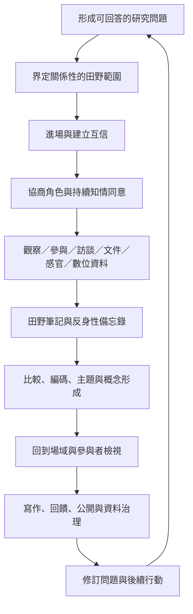

# 田野研究：走進生活世界的觀察、關係與共同知識生產

田野研究不是一套可以從場域抽離的採訪技巧，而是一種在生活世界中生成知識的實踐。研究者走進人們生活、工作、移動、照護、交換與協作的情境，透過觀察、參與、訪談、感官紀錄、文件與數位互動，理解行動如何被關係、制度、歷史與地方知識形塑。

本書將田野研究理解為一個持續往返的循環：提出可回答的問題、協商進場與角色、生成多種資料、反思研究者位置、分析並回到場域檢驗，再與參與者協商如何表述和使用成果。它同時關注方法的可操作性與知識生產中的倫理、權力及互惠。

## 全書主張

1. **田野是關係網絡，不只是地理地點。** 研究場域由人、物、規則、空間、時間、制度與媒介組成，邊界應由研究問題和可追蹤的關係界定。
2. **資料是在關係中生成的。** 訪談、觀察、影像、地圖和線上貼文都受生成情境影響，必須保留來源與脈絡。
3. **研究者不是透明的旁觀者。** 研究者的身份、身體、資源、情緒與位置性會形塑資料，因此反身性需要落實為日常紀錄。
4. **倫理不是一次性審查。** 知情同意、避免傷害、資料保護、成果公開與社群責任都需要持續協商。
5. **參與不等於權力已經共享。** 共同研究應讓參與者真正參與問題定義、分析、資料治理與成果決策。
6. **分析與寫作是知識形成的一部分。** 研究者需要讓讀者看見資料如何支持主張，也要保存反例、分歧與研究限制。

## 建議閱讀路徑

### 入門：建立研究觀
先讀[[moc/田野研究的知識論與研究設計.moc]]，再讀[[田野研究以社會生活世界中的關係與實踐為研究對象]]、[[田野研究設計應從可回答的問題而不是工具開始]]與[[田野資料必須連同生成脈絡一起理解]]。這條路徑先釐清田野研究究竟要理解什麼，以及如何讓研究問題與資料相稱。

### 實作：進場、觀察與訪談
接著讀[[moc/田野進場與互動方法概念地圖.moc]]，搭配[[田野進場是關係建立而非單純取得入場許可]]、[[參與觀察要在參與與分析距離之間持續調整]]、[[訪談敘事是共同生成的知識而不是透明的事實複製]]與[[田野筆記應區分描述分析與反身性紀錄]]。需要具體操作時，可使用[[idea/建立三層田野筆記模板避免觀察與推論混淆]]。

### 倫理與權力：從對人研究走向與人研究
閱讀[[moc/田野倫理位置性與去殖民研究概念地圖.moc]]，再讀[[田野倫理應以關係責任檢視每一個研究決定]]、[[知情同意是一段可持續撤回與更新的過程]]、[[研究者位置性是知識生產的條件而不是背景資料]]、[[參與式方法應將分析主導權交還給社群]]與[[去殖民研究必須重新分配知識與資料的決定權]]。此路徑特別適合跨文化、社區、原住民族或權力不對等的研究。

### 擴展：跨地域、數位與感官田野
閱讀[[moc/跨地域數位與感官田野概念地圖.moc]]，再讀[[多點田野以追蹤關係而不是蒐集地點為核心]]、[[數位田野必須將平台治理納入研究脈絡]]與[[感官細節能揭示日常秩序中不易言說的規則]]。可透過[[idea/用固定日常路徑練習多感官田野觀察]]與[[idea/追蹤一件物品繪製跨場域的社會關係圖]]展開練習。

### 自然環境與公民科學：把環境測量與地方知識連起來
閱讀[[moc/自然環境與公民科學田野概念地圖.moc]]，搭配[[生態田野方法可結合樣區樣線與社會生態脈絡]]、[[公民科學能擴大環境監測但需要處理偏差與資料品質]]與[[田野資料管理必須從研究設計與現場採集階段開始]]。這條路徑將方法拓展至生態監測、社區觀測與長期資料管理。

### 分析與表述：把材料轉化為可檢視的主張
最後閱讀[[moc/田野分析與知識表述概念地圖.moc]]，搭配[[分析應在資料與概念之間反覆往返]]、[[三角檢證能增加比較能力但不能消除觀點差異]]、[[田野寫作要讓讀者看見證據如何支持主張]]與[[研究成果應由參與者共同檢視與決定用途]]。分析不是把資料整理成整齊分類，而是呈現證據、詮釋、不同意見與限制的關係。

## 研究流程速覽

## 資料夾導覽

### 概念地圖 `moc`

* [[moc/田野倫理位置性與去殖民研究概念地圖.moc]]
* [[moc/田野分析與知識表述概念地圖.moc]]
* [[moc/田野研究的知識論與研究設計.moc]]
* [[moc/田野進場與互動方法概念地圖.moc]]
* [[moc/自然環境與公民科學田野概念地圖.moc]]
* [[moc/跨地域數位與感官田野概念地圖.moc]]

### 靈感筆記 `idea`

* [[idea/共同設計研究問題讓參與者決定真正重要的事]]
* [[idea/建立一週微型田野循環練習觀察分析與回訪]]
* [[idea/建立三層田野筆記模板避免觀察與推論混淆]]
* [[idea/把拒訪沉默與缺席當成田野現象而非資料缺口]]
* [[idea/把田野成果轉成社群可使用的多種形式]]
* [[idea/為每個田野關係建立互惠與退出協議]]
* [[idea/為田野團隊建立資料字典試測與備份流程]]
* [[idea/用反身性備忘錄追蹤研究者如何改變研究方向]]
* [[idea/用固定日常路徑練習多感官田野觀察]]
* [[idea/用數位與實體雙重日誌比較同一社群的互動]]
* [[idea/用社區地圖與時間地圖呈現居民的地方知識]]
* [[idea/與居民共同建立社區生物多樣性觀察計畫]]
* [[idea/讓參與者共同檢視研究分析而不是只校對逐字稿]]
* [[idea/追蹤一件物品繪製跨場域的社會關係圖]]

### 概念筆記 `term`

* [[term/三角檢證]]
* [[term/主題分析]]
* [[term/內位與外位觀點]]
* [[term/公民科學]]
* [[term/半結構式訪談]]
* [[term/厚描]]
* [[term/去殖民研究方法]]
* [[term/參與式行動研究]]
* [[term/參與觀察]]
* [[term/反身性]]
* [[term/口述歷史]]
* [[term/多點民族誌]]
* [[term/守門人]]
* [[term/感官民族誌]]
* [[term/數位民族誌]]
* [[term/樣區法]]
* [[term/樣線法]]
* [[term/民族誌]]
* [[term/焦點團體]]
* [[term/理論抽樣]]
* [[term/生態田野抽樣]]
* [[term/田野倫理]]
* [[term/田野研究]]
* [[term/田野筆記]]
* [[term/田野調查]]
* [[term/目的性抽樣]]
* [[term/知情同意]]
* [[term/研究場域]]
* [[term/研究者位置性]]
* [[term/研究設計]]
* [[term/研究資料管理]]
* [[term/社會生態系統]]
* [[term/社群資料治理]]
* [[term/網路民族誌]]
* [[term/質性訪談]]

### 永久筆記 `note`

* [[note/三角檢證能增加比較能力但不能消除觀點差異]]
* [[note/公民科學資料的代表性來自抽樣設計而非參與人數]]
* [[note/公開可見的數位內容不等於可無限制使用]]
* [[note/分析應在資料與概念之間反覆往返]]
* [[note/去殖民研究必須重新分配知識與資料的決定權]]
* [[note/參與式方法應將分析主導權交還給社群]]
* [[note/參與式行動研究將研究視為共同探究與集體實踐]]
* [[note/參與觀察要在參與與分析距離之間持續調整]]
* [[note/反身性必須落實為可追蹤的日常紀錄]]
* [[note/問題設計應從具體生活事件而非抽象立場開始]]
* [[note/多點田野以追蹤關係而不是蒐集地點為核心]]
* [[note/感官田野應把感知描述連回具體活動與制度]]
* [[note/感官細節能揭示日常秩序中不易言說的規則]]
* [[note/數位田野必須將平台治理納入研究脈絡]]
* [[note/田野倫理應以關係責任檢視每一個研究決定]]
* [[note/田野寫作要讓讀者看見證據如何支持主張]]
* [[note/田野抽樣應隨研究問題與新發現迭代調整]]
* [[note/田野研究以社會生活世界中的關係與實踐為研究對象]]
* [[note/田野研究設計應從可回答的問題而不是工具開始]]
* [[note/田野筆記應區分描述分析與反身性紀錄]]
* [[note/田野資料必須連同生成脈絡一起理解]]
* [[note/田野資料管理必須從研究設計與現場採集階段開始]]
* [[note/田野進場是關係建立而非單純取得入場許可]]
* [[note/田野邊界應由研究對象的關係網絡界定]]
* [[note/知情同意是一段可持續撤回與更新的過程]]
* [[note/研究成果應由參與者共同檢視與決定用途]]
* [[note/研究成果的公開與典藏必須重新協商同意]]
* [[note/研究者位置性是知識生產的條件而不是背景資料]]
* [[note/研究者需要保護田野紀錄並預先規劃資料生命週期]]
* [[note/社會生態田野應把環境測量與地方生活經驗連結]]
* [[note/社群資料治理應尊重集體權利與地方規範]]
* [[note/訪談敘事是共同生成的知識而不是透明的事實複製]]
* [[note/跨文化研究必須讓比較單位接受情境檢驗]]
* [[note/身體不是田野工具之外的干擾而是知識條件]]

### 文獻筆記 `data`

* [[data/公民科學能擴大環境監測但需要處理偏差與資料品質]]
* [[data/原住民族方法論要求研究回應社群自主與知識主權]]
* [[data/去殖民方法的實踐需要在地研究者重新創造研究工具]]
* [[data/參與式研究的品質取決於誰掌握問題與分析權]]
* [[data/參與式農村評估讓地方居民共同分析生活條件]]
* [[data/參與觀察透過共同活動理解行動的情境意義]]
* [[data/反身性主題分析把研究者視為主動的分析參與者]]
* [[data/口述歷史把敘事者尊嚴與長期關係納入研究流程]]
* [[data/哥倫比亞參與式行動研究把知識生產連結社會轉變]]
* [[data/多點民族誌透過追蹤連結理解跨地方社會過程]]
* [[data/實務反身性讓研究者看見自身假設如何影響研究]]
* [[data/感官民族誌將身體感知納入知識與實踐研究]]
* [[data/數位民族誌需要同時研究平台環境與線下關係]]
* [[data/民族誌田野筆記需要從現場片段發展成可分析的描述]]
* [[data/生態田野方法可結合樣區樣線與社會生態脈絡]]
* [[data/生態田野資料品質取決於問題變項與標準化紀錄]]
* [[data/田野倫理必須持續協商而不止於簽署同意書]]
* [[data/研究品質需要透明的研究決策與多來源對照]]
* [[data/研究者需要保護田野紀錄並預先規劃資料生命週期]]
* [[data/訪談品質取決於問題設計互動倫理與分析方式]]
* [[data/設計民族誌把觀察訪談數位與參與式方法納入設計田野]]
* [[data/質性研究適合回答經驗如何被理解與脈絡如何形塑現象]]
* [[data/跨文化田野中的內外人位置會隨情境變動]]

## 如何使用這本書

* 先以研究問題選擇 MOC，再進入概念詞條與永久筆記，不必從頭線性讀完。
* 將新的訪談、觀察、文件或田野案例先寫成獨立文獻筆記，再把可重用的推論拆成永久筆記。
* 一張卡片只保留一個主要主張；若同一篇筆記包含多個可獨立成立的主張，拆成多張並互相連結。
* 靈感筆記要包含可執行步驟與倫理界線，避免把研究想法誤當成已驗證結論。
* 新增田野資料時，保留資料生成脈絡、同意範圍與存取限制；不應把參與者的私密資訊直接匯入公開知識庫。

## 方法上的限制與提醒

田野研究無法讓研究者「完整看見」一個社群，也不應以少量觀察推論整個文化。不同方法回答不同問題；參與者之間可能存在衝突，研究者也可能無法接觸某些場域。研究報告應誠實呈現選擇、缺席、限制與不確定性。

本書以跨學科方法論與不同地域案例建立起步架構，並非所有領域或社群的完整代表。特別是原住民族研究、敏感議題、未成年人、線上封閉社群與高風險場域，必須依當地法律、專業倫理及社群自身規範重新設計研究。

## 核心閱讀清單

* [AAA Anthropological Ethics](https://americananthro.org/about/anthropological-ethics/)
* [Te Ara Tika: Māori Research Ethics Guidelines](https://www.hrc.govt.nz/resources/te-ara-tika-guidelines-maori-research-ethics)
* [Oral History Association: Principles and Best Practices](https://oralhistory.org/principles-and-best-practices-revised-2018/)
* [Decolonizing Methodologies, 3rd edition](https://www.bloomsbury.com/us/decolonizing-methodologies-9781350346086/)
* [Writing Ethnographic Fieldnotes, 2nd edition](https://press.uchicago.edu/ucp/books/book/chicago/W/bo12182616.html)
* [Doing Sensory Ethnography, 2nd edition](https://www.sagepub.com/shop/buy-a-book/doing-sensory-ethnography-2-242776)
* [Ethnography in/of the World System: The Emergence of Multi-Sited Ethnography](https://doi.org/10.1146/annurev.an.24.100195.000523)
* [How to use and assess qualitative research methods](https://pmc.ncbi.nlm.nih.gov/articles/PMC7650082/)
