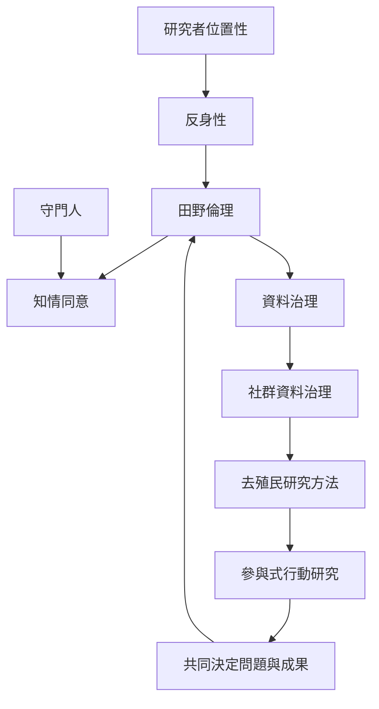

田野倫理不是研究開始前完成的審查，而是研究者在每次互動、記錄、保存與公開中持續回應責任。研究者位置性提醒我們，知識生產受權力關係影響；去殖民與社群資料治理則要求重新檢視誰有權定義問題、解釋資料與決定用途。

## 關係圖

## 概念連結
* [[研究者位置性]]、[[反身性]]、[[田野倫理]]、[[知情同意]]、[[守門人]]
* [[去殖民研究方法]]、[[參與式行動研究]]、[[社群資料治理]]、[[內位與外位觀點]]

## 觀點連結
* [[田野倫理應以關係責任檢視每一個研究決定]]
* [[知情同意是一段可持續撤回與更新的過程]]
* [[研究者位置性是知識生產的條件而不是背景資料]]
* [[去殖民研究必須重新分配知識與資料的決定權]]
* [[參與式方法應將分析主導權交還給社群]]
* [[研究者需要保護田野紀錄並預先規劃資料生命週期]]
* [[為每個田野關係建立互惠與退出協議]]
