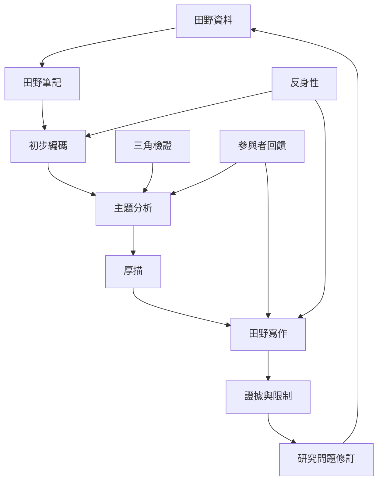

田野分析從資料整理開始，但不止於編碼。研究者在資料、概念、反例與新問題之間往返，透過厚描、主題分析、比較與寫作形成主張。報告需要讓讀者看見資料如何支持解釋，也要說明研究者的位置、限制與仍未解決的分歧。

## 關係圖

## 概念連結
* [[田野筆記]]、[[反身性]]、[[主題分析]]、[[厚描]]、[[三角檢證]]
* [[民族誌]]、[[質性訪談]]、[[口述歷史]]、[[內位與外位觀點]]

## 觀點連結
* [[分析應在資料與概念之間反覆往返]]
* [[三角檢證能增加比較能力但不能消除觀點差異]]
* [[田野資料必須連同生成脈絡一起理解]]
* [[田野寫作要讓讀者看見證據如何支持主張]]
* [[讓參與者共同檢視研究分析而不是只校對逐字稿]]
* [[把田野成果轉成社群可使用的多種形式]]
