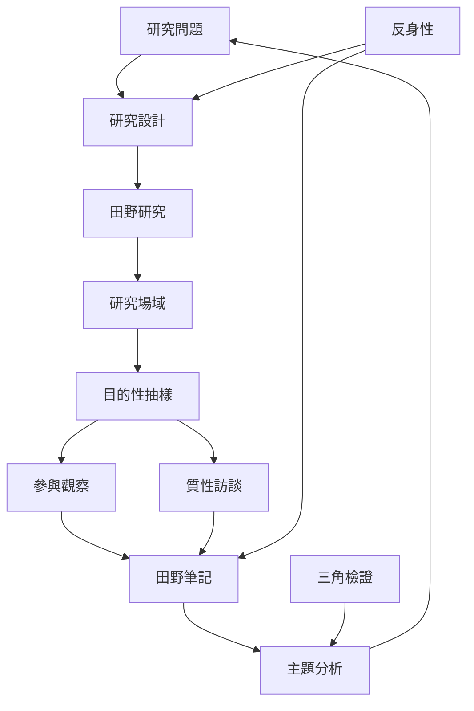

田野研究以生活世界中的行動、關係與意義為研究對象。它不是某個固定技術，而是把研究問題、場域、抽樣、資料生成與分析安排成一個能不斷修訂的循環。這張圖以研究問題為中心，連接[[田野研究]]、[[研究設計]]、[[民族誌]]與不同資料生成方法。

## 關係圖

## 概念連結
* [[田野研究]]、[[田野調查]]、[[研究設計]]、[[研究場域]]、[[目的性抽樣]]、[[理論抽樣]]
* [[民族誌]]、[[參與觀察]]、[[質性訪談]]、[[半結構式訪談]]、[[焦點團體]]、[[田野筆記]]
* [[質性訪談]]、[[主題分析]]、[[三角檢證]]、[[反身性]]、[[研究者位置性]]

## 觀點連結
* [[田野研究以社會生活世界中的關係與實踐為研究對象]]
* [[田野研究設計應從可回答的問題而不是工具開始]]
* [[田野抽樣應隨研究問題與新發現迭代調整]]
* [[分析應在資料與概念之間反覆往返]]
* [[研究品質需要透明的研究決策與多來源對照]]
* [[建立三層田野筆記模板避免觀察與推論混淆]]
