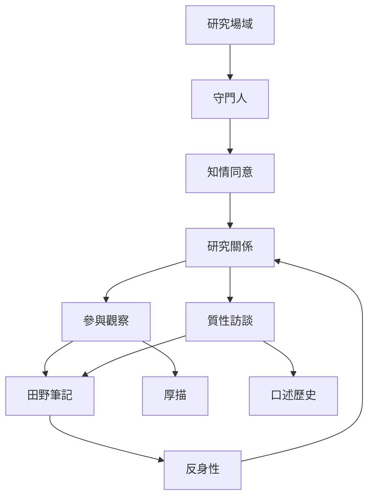

田野進場和資料生成都是關係性的實作。研究者需要理解場域規則、與守門人和參與者協商角色，並在觀察、訪談、共同活動與筆記之間形成能互相補充的資料。此地圖聚焦「如何進入、如何互動、如何紀錄」。

## 關係圖

## 概念連結
* [[研究場域]]、[[守門人]]、[[田野調查]]、[[知情同意]]、[[田野倫理]]
* [[參與觀察]]、[[質性訪談]]、[[半結構式訪談]]、[[口述歷史]]、[[焦點團體]]
* [[田野筆記]]、[[反身性]]、[[研究者位置性]]、[[厚描]]

## 觀點連結
* [[田野進場是關係建立而非單純取得入場許可]]
* [[參與觀察要在參與與分析距離之間持續調整]]
* [[訪談敘事是共同生成的知識而不是透明的事實複製]]
* [[問題設計應從具體生活事件而非抽象立場開始]]
* [[田野筆記應區分描述分析與反身性紀錄]]
* [[把拒訪沉默與缺席當成田野現象而非資料缺口]]
