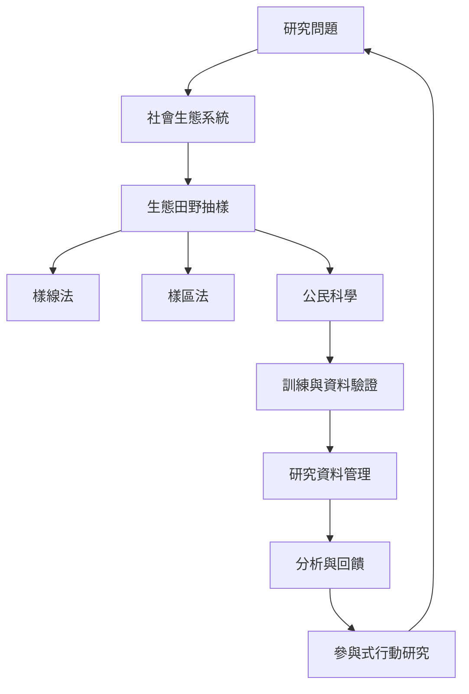

田野研究也存在於生態學、環境科學與社會生態系統研究。這些領域需要將研究問題轉成可重複的觀測程序，設計樣線、樣區或樣點，處理觀測者差異與資料品質；公民科學則讓更多人參與長期監測。當研究涉及環境與地方生活的互動時，生態測量、地方知識與參與式分析應互相補充。

## 關係圖

## 概念連結
* [[生態田野抽樣]]、[[樣線法]]、[[樣區法]]、[[公民科學]]、[[社會生態系統]]、[[研究資料管理]]
* [[研究設計]]、[[田野研究]]、[[參與式行動研究]]、[[社群資料治理]]

## 觀點連結
* [[生態田野方法可結合樣區樣線與社會生態脈絡]]
* [[公民科學資料的代表性來自抽樣設計而非參與人數]]
* [[田野資料管理必須從研究設計與現場採集階段開始]]
* [[社會生態田野應把環境測量與地方生活經驗連結]]
* [[與居民共同建立社區生物多樣性觀察計畫]]
* [[為田野團隊建立資料字典試測與備份流程]]
