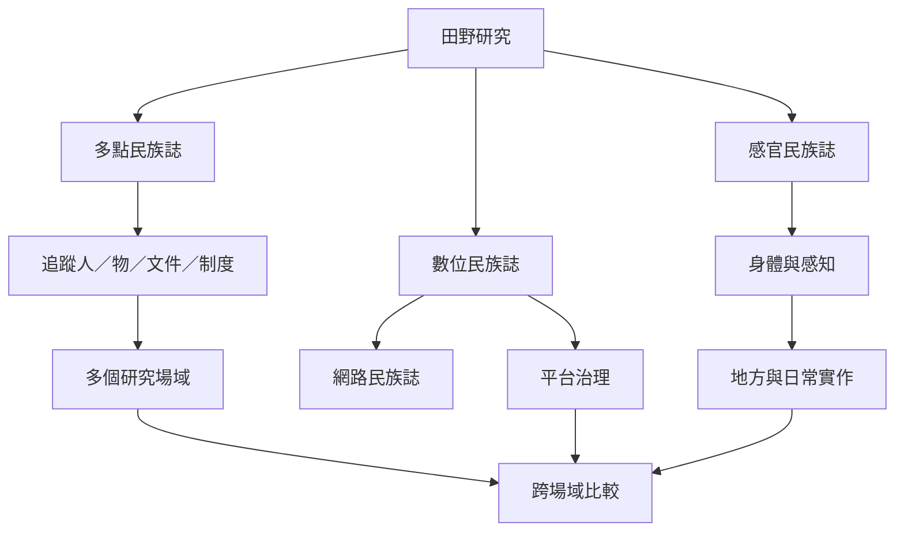

當研究對象跨越地點、媒介與身體經驗時，單一場域的觀察往往不足。多點民族誌追蹤人、物與制度的流動；數位民族誌處理平台脈絡；感官民族誌則關注身體感知如何與地方和實作相連。三者共同擴展田野的界線，但都需要明確說明追蹤邏輯與倫理界線。

## 關係圖

## 概念連結
* [[多點民族誌]]、[[研究場域]]、[[田野研究]]、[[民族誌]]
* [[數位民族誌]]、[[網路民族誌]]、[[知情同意]]
* [[感官民族誌]]、[[參與觀察]]、[[田野筆記]]、[[厚描]]

## 觀點連結
* [[多點田野以追蹤關係而不是蒐集地點為核心]]
* [[田野邊界應由研究對象的關係網絡界定]]
* [[數位田野必須將平台治理納入研究脈絡]]
* [[公開可見的數位內容不等於可無限制使用]]
* [[感官細節能揭示日常秩序中不易言說的規則]]
* [[用固定日常路徑練習多感官田野觀察]]
* [[追蹤一件物品繪製跨場域的社會關係圖]]
